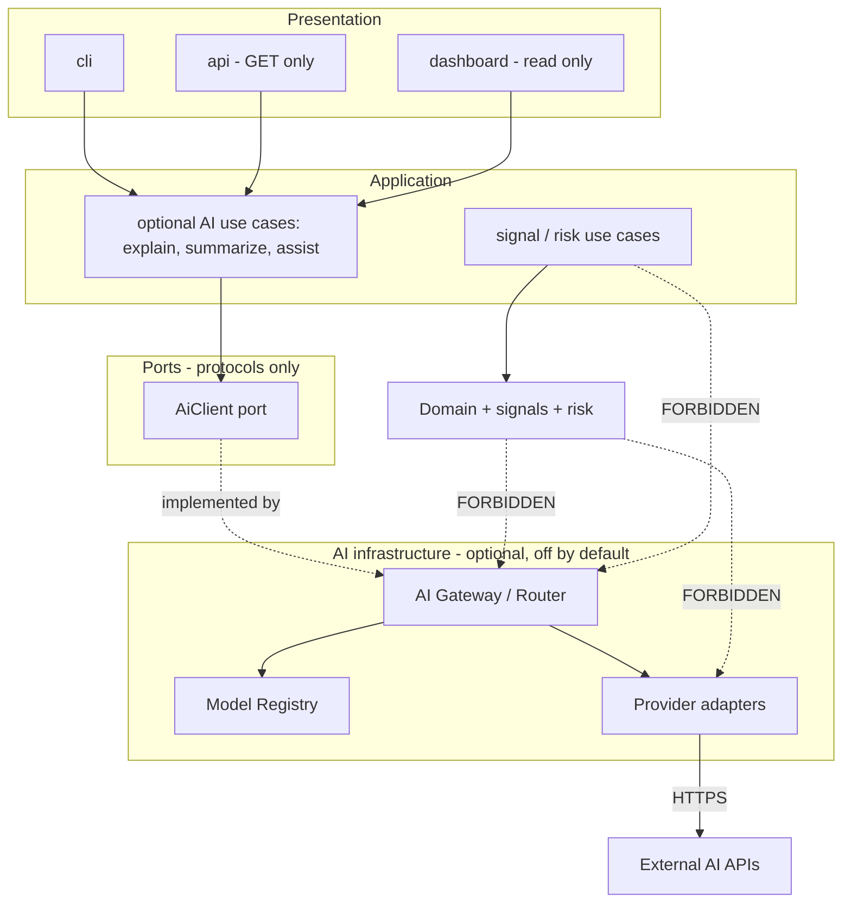
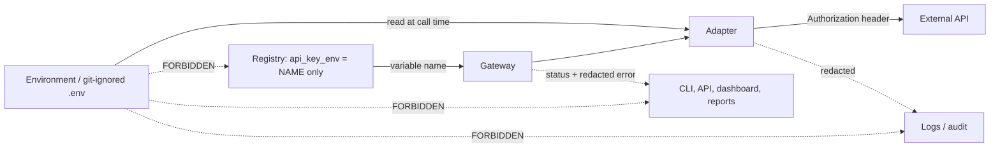
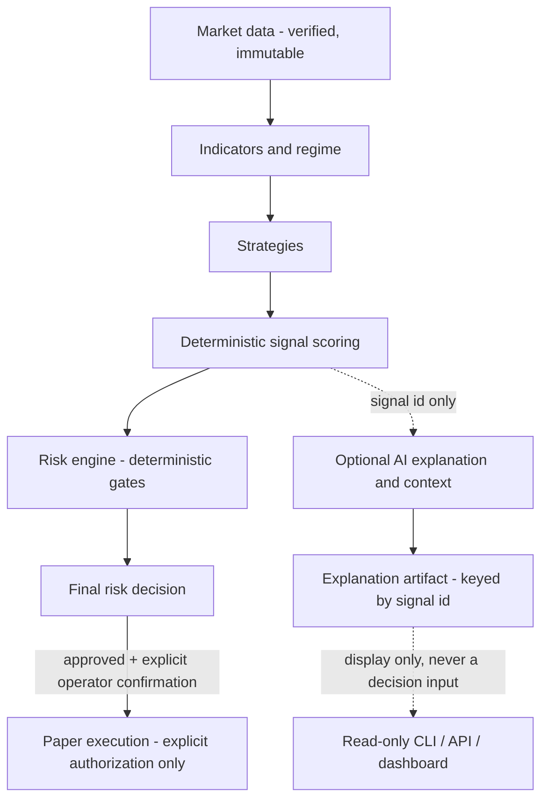
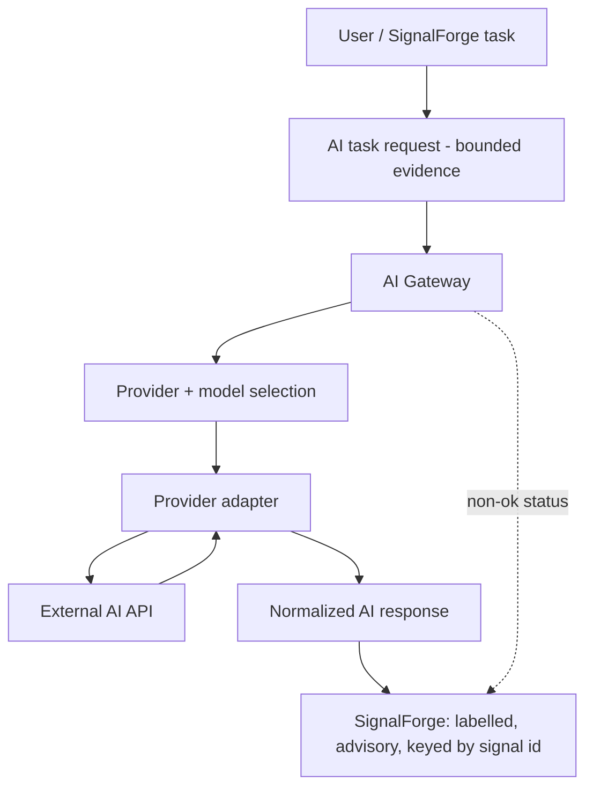
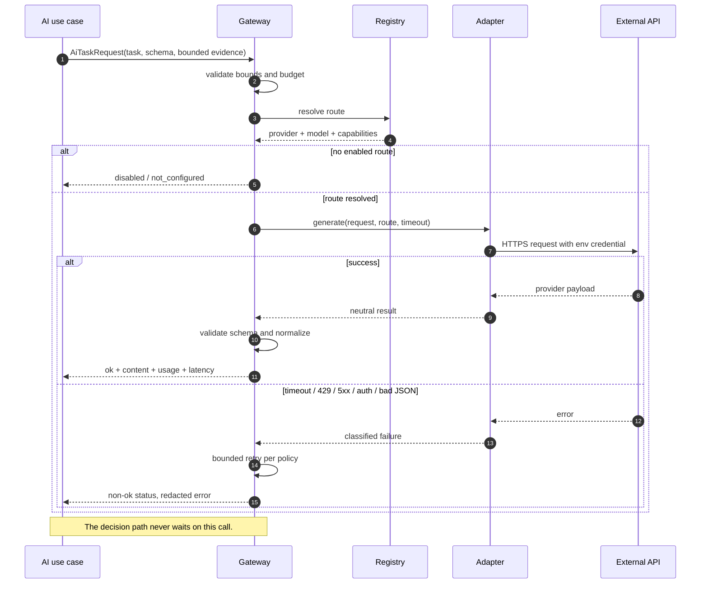
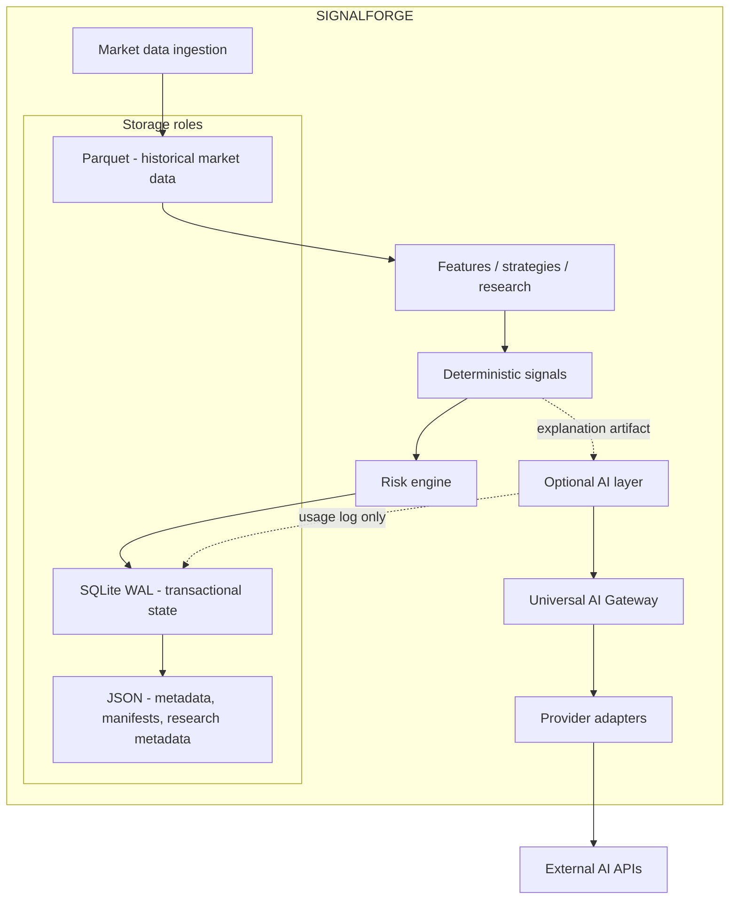

# Universal AI Gateway

**Status: IMPLEMENTED (Stages 0–5, 2026-11-07) — sections 1–15 are the design
contract; §16 records exactly what exists.**

The provider-neutral core, registry, gateway, one OpenAI-compatible adapter,
bounded signal/research advisory layers, composition root and `sf ai` CLI exist
in `src/crypto_engine/ai/` (uncommitted at the time of writing). No provider
SDK, no local LLM runtime, no network call in tests and no live credential are
part of the implementation. AI output remains advisory-only and can never
change signal direction, risk, position size, approval, execution, circuit
breakers or ledgers.

Authorization: this implementation required explicit user approval, which was
recorded before the first line of code. `AGENTS.md` still authorizes Phase 10
only; this document authorizes nothing beyond the approved AI stages.

---

## 1. Purpose

SignalForge must be able to use AI capabilities without ever depending on one
AI vendor, and without letting AI influence a trading decision.

The design therefore has one rule above all others:

> **The domain, signal, risk and execution code must not know that AI exists.**

Everything else follows: a neutral port, a single gateway, isolated adapters,
a provider/model registry, task-based routing, a hard secret boundary, explicit
failure states, and an advisory-only authority boundary.

## 2. Current state vs target (honest comparison)

The repository already contains a working, optional, provider-neutral AI layer.
This document re-homes and formalizes it; it does not invent a parallel system.

| Concern | Current (verified 2026-11-07) | Target |
|---|---|---|
| Package | `src/crypto_engine/ai_providers/` (12 modules) | `ports/ai.py` + `ai/` package |
| Contract | pydantic `AiRequest` / `AiResponse` in `ai_providers/types.py` | Port DTOs in `ports/ai.py` (dataclasses) + gateway-normalized response |
| Entry point | `create_provider()` factory + `run_with_fallback()` | `AiGateway` implementing the `AiClient` port |
| Adapters | 8: `openai`, `anthropic`, `gemini`, `deepseek`, `openrouter`, `groq`, `ollama`, `compatible` | Same families, one directory each, plus declared capability metadata |
| Transport | stdlib `urllib` by default; SDKs bring-your-own and optional | Same policy; SDK imports confined to the adapter module |
| Budgets | `BudgetTracker` (max requests, concurrency 1) | Gateway-owned budgets, plus timeout/rate/token/cost points |
| Routing | `default_provider` + `fallback_order` | Task-based routing with per-task provider/model selection |
| Registry | `[[ai.providers]]` entries in `config/default.toml` | Provider + model registry (config + metadata), no secrets |
| Default | All providers disabled | Unchanged: disabled by default |
| Authority | Advisory only; analysts cannot alter direction/score/risk | Unchanged and made structural |

The current layer already satisfies most of the *contract shape*. The target
adds capability metadata, task routing, a single gateway seam and an explicit
provider/model registry. It is a re-homing, not a rewrite.

## 3. Position in the architecture



Reading rule: solid arrows are compile-time imports; dashed arrows are
implementation or network relationships resolved at the composition root.
The two `FORBIDDEN` edges are the core of the design: no domain, signal or risk
module may import the gateway or an adapter. AI results reach those modules
only as inert values produced before they run, and never as an input to a
decision.

## 4. AI Port

### 4.1 Contract rules

1. The port lives in `ports/ai.py` and contains only `typing.Protocol`
   definitions, `dataclass` DTOs and type aliases (rule DR-2).
2. It imports the Python standard library only. No vendor name, no HTTP client,
   no SDK type, no credential, no URL.
3. It expresses **capabilities**, not vendor behaviour. A caller asks for a
   task; it never names an endpoint, a header or a request dialect.
4. It is optional: the application must be constructible with no AI
   implementation at all (a `NullAiClient` that always returns `disabled`).
5. It is synchronous and single-flight in the baseline. Streaming, tools and
   asynchronous fan-out are not part of the port.

### 4.2 Request (conceptual fields)

| Field | Type | Required | Meaning |
|---|---|---|---|
| `request_id` | str | yes | Correlation id; appears in logs and the response |
| `task_id` | enum | yes | `signal_explanation`, `research_summary`, `assistant`, `news_analysis`, `macro_analysis` |
| `output_schema_id` | str | yes | Closed schema the response must satisfy, e.g. `signal_explanation.v1` |
| `evidence` | mapping | yes | Bounded, typed evidence (max 64 keys, max 8,000 chars per value) |
| `task_text` | str | yes | Constant, application-owned instruction; never built from untrusted text |
| `related_ids` | mapping | no | `signal_id`, `dataset_id`, `run_id` for traceability |
| `max_output_tokens` | int | no | Bounded by configuration |
| `timeout_s` | float | no | May lower, never raise, the configured ceiling |
| `actor` | enum | yes | `operator`, `cli`, `scheduler`; used for audit only |

The request contains **no** provider, model, endpoint, API key or arbitrary
HTTP option. Provider/model selection is a routing concern, not a caller
concern. A trusted operator override may be supplied at the CLI boundary and is
validated against the registry by the gateway, never passed through the port.

### 4.3 Response (conceptual fields)

| Field | Type | Meaning |
|---|---|---|
| `request_id` | str | Echo of the request |
| `task_id` | str | Echo of the task |
| `status` | enum | See §4.4; `ok` only on schema-valid success |
| `provider_id` | str \| null | Resolved provider; null when nothing was called |
| `model_id` | str \| null | Resolved model; null when nothing was called |
| `route_id` | str \| null | Which routing rule produced this call |
| `content` | mapping \| null | Schema-validated structured output |
| `text` | str \| null | Bounded, plain-text explanation (never HTML) |
| `usage` | mapping | `input_tokens`, `output_tokens`, `total_tokens` where reported |
| `latency_ms` | int | Measured by the gateway, not the provider |
| `attempts` | int | Total adapter calls, including retries |
| `error` | mapping \| null | `code`, redacted `message`, `retryable`, optional provider status |
| `created_at` | str | ISO-8601 UTC |

`content` and `text` are **data**. They are never rendered as HTML, never
executed, never parsed as instructions, and never written into a canonical
signal, risk or ledger record.

### 4.4 Status vocabulary (closed)

| Status | Meaning | Retryable |
|---|---|---|
| `ok` | Adapter returned schema-valid output | — |
| `disabled` | No AI configured or explicitly disabled | No |
| `not_configured` | Route references a provider/model that is absent or disabled | No |
| `invalid_request` | Request violates bounds or schema | No |
| `auth_failure` | Missing key, 401 or 403 | No |
| `rate_limited` | Provider 429 or local rate limit | Yes, bounded |
| `timeout` | Connect or read timeout exceeded | Yes, bounded |
| `provider_outage` | 5xx, DNS or connection failure | Yes, bounded |
| `unsupported` | Provider/model cannot satisfy the capability or schema | No |
| `invalid_output` | Non-JSON, wrong shape, or schema violation | No |
| `budget_exhausted` | Request/token/cost budget spent | No |
| `cancelled` | Operator aborted | No |
| `internal_error` | Defect in SignalForge, not the provider | No |

The vocabulary is closed. Adding a status is an architecture change, not an
implementation detail, because status values are observable in the CLI, the API
and the audit record.

### 4.5 Capability metadata

Each provider/model declares capabilities so the gateway can refuse a request
that cannot be satisfied instead of discovering it mid-call:

| Capability | Type | Meaning |
|---|---|---|
| `structured_output` | enum | `none`, `json_mode`, `json_schema` |
| `text_generation` | bool | Baseline capability |
| `max_context_tokens` | int | Hard input ceiling |
| `max_output_tokens` | int | Hard output ceiling |
| `reasoning_metadata` | bool | Provider may return reasoning/trace metadata |
| `usage_reporting` | enum | `exact`, `estimated`, `none` |
| `modalities` | list | Target: `["text"]` only |
| `tool_calling` | bool | Always `false` in this design; no tools are ever exposed |
| `streaming` | bool | Declared for information; not used by the baseline |
| `local` | bool | `true` only for a local-inference adapter |

Capabilities are declared by the adapter and cross-checked against the
registry at load. A mismatch is a configuration error, not a runtime surprise.

### 4.6 What the port must not express

- Provider-specific parameters (`top_p` dialects, vendor headers, project ids).
- Raw SDK request/response objects.
- Streaming handles, callbacks or async generators.
- Credentials, endpoints or header maps.
- Tool/function definitions or shell/filesystem access.
- Anything that would let a caller choose a model outside the registry.

## 5. AI Gateway / Router

The gateway is the **single application-level entry point** for AI requests.
Nothing else may call a provider adapter.

### 5.1 Responsibilities

| # | Responsibility | Detail |
|---|---|---|
| 1 | Validate the request | Bounds, closed schema id, task id, no unknown fields |
| 2 | Resolve the route | Task route, then default, then explicit operator override |
| 3 | Check enablement | Provider and model both enabled; otherwise `not_configured` |
| 4 | Check budgets | Request, token and optional cost budget before any network call |
| 5 | Enforce concurrency | Exactly one request in flight by default |
| 6 | Apply timeout policy | Connect and read timeouts, hard total deadline |
| 7 | Call one adapter | Never fan out to several providers in parallel |
| 8 | Classify the error | Map transport/provider errors into the closed status vocabulary |
| 9 | Apply retry policy | Bounded attempts, exponential backoff, `Retry-After` respected |
| 10 | Validate the output | Parse JSON and validate against `output_schema_id` |
| 11 | Normalize | Produce the port response; discard provider envelopes |
| 12 | Record usage | Request count, tokens, latency, status, route, redacted error |
| 13 | Redact | Strip secrets and payloads before logging or returning |

### 5.2 Explicit non-responsibilities

The gateway must **not**:

- contain trading strategy, scoring or confluence logic;
- calculate, adjust or veto risk;
- approve, reject or size a trade;
- submit, amend or cancel an order;
- mutate a `SignalRecord`, a `RiskDecision` or a ledger entry;
- choose a model by price at runtime without an explicit, recorded policy;
- silently substitute a different task or a different output schema;
- retry a non-retryable status (auth, invalid output, unsupported, budget).

### 5.3 Failure policy

The gateway never converts a failure into a success, and never returns partial
provider text as if it were schema-valid. On failure it returns a non-`ok`
status with a redacted error, records the attempt, and the caller treats the AI
context as unavailable.

## 6. Provider adapters

### 6.1 Target layout (design only; do not create yet)

```text
src/crypto_engine/
  ports/
    ai.py                     # AiClient protocol + DTOs (stdlib only)
  ai/                         # OPTIONAL infrastructure, off by default
    gateway.py                # implements AiClient; the only adapter caller
    registry.py               # provider + model registry (no secrets)
    routing.py                # task -> route resolution
    schemas/                  # closed output schemas (signal_explanation.v1, ...)
    providers/
      openai/
      anthropic/
      google/
      meta/
      nvidia/
      custom/                 # OpenAI-compatible endpoint adapter
```

This tree is a target. `ports/ai.py` and `ai/` do not exist today; the current
code lives in `ai_providers/` (see §2 and `TARGET_REPOSITORY_STRUCTURE.md`).

### 6.2 Adapter contract

An adapter must expose exactly:

| Member | Purpose |
|---|---|
| `provider_id` | Stable identifier used by the registry |
| `capabilities` | Declared capability record (§4.5) |
| `generate(request, route, timeout_s) -> ProviderResult` | One HTTP exchange, translated into neutral terms |
| `close()` | Release any pooled resources (no-op for stateless transports) |

An adapter may:

- read its credential from the environment at call time;
- build the provider-specific HTTP request;
- translate the provider response into `ProviderResult`;
- classify HTTP/transport failures into the closed status vocabulary;
- truncate provider text to configured bounds.

An adapter must not:

- retry (the gateway owns retry policy);
- log request or response bodies, headers or credentials;
- import `domain/`, `signals/`, `risk/`, `portfolio/`, `execution/` or the
  scheduler;
- read configuration files, the registry or the filesystem;
- make more than one outbound request per `generate()` call;
- follow redirects to a host outside the configured egress allowlist;
- decide whether a result is authoritative.

### 6.3 Provider families

| Adapter | Dialect | Notes |
|---|---|---|
| `openai` | OpenAI native | JSON schema structured output where supported |
| `anthropic` | Anthropic messages | Structured output via schema-constrained JSON |
| `google` | Gemini | Current code passes the key as a query parameter; prefer a header transport if the vendor offers one |
| `meta` | Meta/partner-hosted Llama endpoints | Meta does not operate a single first-party general chat API; the slot covers Meta-hosted or partner endpoints and must declare its real dialect |
| `nvidia` | NVIDIA NIM (OpenAI-compatible) | Treated as a first-class provider slot, implemented over the compatible dialect |
| `custom` | OpenAI-compatible | Any base URL + model id + auth mechanism (see §9) |

Current adapters `deepseek`, `openrouter`, `groq` and `ollama` map onto the
same adapter contract. `deepseek`, `openrouter` and `groq` are
OpenAI-compatible dialects; `ollama` is the local-inference exception described
in §13.

### 6.4 One adapter, one dialect

An adapter must not switch dialects based on the model name. If a provider
offers two incompatible APIs, they are two adapters. This keeps capability
declarations honest and error classification testable.

## 7. Model registry

The registry is metadata. It contains no credential values.

### 7.1 Provider record

| Field | Meaning |
|---|---|
| `provider_id` | Stable key (`openai`, `anthropic`, `google`, `meta`, `nvidia`, `custom`) |
| `display_name` | Human label for CLI/dashboard |
| `dialect` | Adapter dialect the provider uses |
| `endpoint` | Base URL where applicable; null for fixed-endpoint providers |
| `capabilities` | Declared capability record |
| `auth_mechanism` | `bearer`, `header`, `query` (documented exception), `none` |
| `api_key_env` | **Name** of the environment variable, never the value |
| `egress_allowlist` | Hosts this provider may contact |
| `enabled` | Operator switch; default `false` |
| `timeout_defaults` | Connect/read ceilings |
| `cost_metadata` | Optional per-million-token prices; informational only |

### 7.2 Model record

| Field | Meaning |
|---|---|
| `provider_id` | Owning provider |
| `model_id` | Provider model identifier |
| `display_name` | Human label |
| `capabilities` | May narrow, never widen, the provider capabilities |
| `context_limit` | Input token ceiling |
| `max_output_tokens` | Output ceiling |
| `structured_output` | Whether the closed schemas are supported |
| `enabled` | Operator switch; default `false` |
| `notes` | Free text, non-secret |

### 7.3 Selection rules

1. Selection is configuration, never code. Changing provider or model is a
   validated configuration edit, not a source change.
2. Unknown provider, unknown model, disabled entry or capability mismatch is an
   explicit `not_configured` / `unsupported` failure.
3. The registry is read-only at runtime. The gateway never writes to it.
4. The registry may be expressed as TOML (`config/`) plus optional JSON
   metadata. It must never contain a secret value, a token or a private URL
   with embedded credentials.
5. A provider can be enabled while every model under it is disabled; the
   effective state is the intersection.

## 8. Task-based model selection

One model does not have to serve every task.

| Task | Typical route | Why it may differ |
|---|---|---|
| `signal_explanation` | Small, cheap, structured-output model | High frequency; short output; schema-critical |
| `research_summary` | Larger-context model | Long evidence, lower frequency |
| `assistant` | Best conversational model | Interactive, quality-sensitive |
| `news_analysis` | Model with strong extraction | Untrusted long text; schema-critical |
| `macro_analysis` | Model with strong reasoning | Low frequency, narrative evidence |

Routing configuration (conceptual; not added to the repo):

```toml
[ai.tasks.signal_explanation]
route = ["openai:gpt-4o-mini", "custom:local-summary"]  # ordered fallback
max_output_tokens = 256
timeout_s = 15
max_requests_per_task = 20

[ai.tasks.research_summary]
route = ["anthropic:claude-sonnet"]
max_output_tokens = 1200
timeout_s = 60
max_requests_per_task = 4
```

Resolution order:

```text
explicit operator override (trusted CLI only)
  -> task route (first enabled entry)
  -> [ai].default_provider default model
  -> disabled (status = not_configured)
```

Rules:

- Fallback stays **inside** the task's declared route list. The gateway never
  falls back to a provider that was not approved for that task.
- Every fallback attempt is recorded with its route id and status.
- A task with no route is disabled, not silently mapped to another task.
- Budgets are per task and per run, in addition to global budgets.

## 9. Custom endpoint support

Required to support self-hosted gateways, aggregators and third-party
OpenAI-compatible services without touching SignalForge core code.

| Requirement | Rule |
|---|---|
| Base URL | Configurable, validated absolute URL; HTTPS required except for loopback |
| Model identifier | Configurable string, validated against the model record |
| Authentication | `bearer` (default) or `none` for loopback-only services (implemented); `header`/`query` are validated but fail closed as `unsupported` |
| Secret | Environment variable only; never in the URL, the registry or logs |
| Capabilities | Declared explicitly; unknown capabilities default to the conservative value |
| TLS | Certificate verification always on; no "disable verify" option |
| Egress | Request host must match the provider's `egress_allowlist` (empty = base-URL host only); redirects are refused |
| Timeouts | Same gateway ceilings; no provider-specific escape hatch |
| Response dialect | OpenAI-compatible chat/completions shape, mapped to the neutral response |
| Local inference | Allowed only as an explicitly optional adapter; not the baseline |

A custom endpoint is **not** a trust promotion. Its output is untrusted input,
validated against the same closed schema, and carries the same absence of
authority as any other provider.

## 10. Secret boundary



### 10.1 Allowed

- Environment variables and a git-ignored `.env` file.
- The environment variable **name** in configuration and the registry.
- Reading the value inside the adapter at call time.
- Redaction helpers that replace known secret values with a fixed marker.

### 10.2 Forbidden

Secrets must never be:

- committed to Git, including in test fixtures, notebooks or sample configs;
- hard-coded in source or in `config/default.toml`;
- stored in source-controlled JSON, manifests, reports, research output or
  model metadata;
- written to logs, audit records, signal history or error messages;
- returned by any API response or rendered by the dashboard;
- placed in a URL query string (the current Gemini adapter does this because
  the vendor API requires it; it is recorded as a residual risk, not a
  pattern to copy);
- embedded in a custom endpoint URL;
- included in a crash dump, traceback or exception string.

### 10.3 Enforcement

| Control | Requirement |
|---|---|
| Redaction | Adapter errors pass through a redactor that knows the configured secret values |
| Logging | Request/response bodies are never logged at any level |
| API/dashboard | No field exists that could carry a key; secret scan test asserts absence |
| Reports | Report writer rejects secret-like keys and known values |
| Tests | An env-secret scan test proves no configured value appears in responses or files |
| Rotation | Changing the environment value takes effect on the next call; no cache of secret values |
| Storage | No credential is persisted anywhere; a restart requires the environment again |

## 11. Failure isolation

AI is optional. Every failure below leaves the deterministic core exactly as it
would have been with AI disabled.

| Failure | Status | Retry | Effect on SignalForge |
|---|---|---|---|
| No provider configured | `disabled` | No | AI context absent; signal unchanged |
| Invalid/missing key | `auth_failure` | No | AI context absent; visible warning |
| Provider down | `provider_outage` | Bounded | AI context absent; visible warning |
| Timeout | `timeout` | Bounded | AI context absent; visible warning |
| Rate limit | `rate_limited` | Bounded, `Retry-After` | AI context absent; visible warning |
| Model unavailable | `not_configured` / `unsupported` | No | AI context absent; visible warning |
| Network failure | `provider_outage` | Bounded | AI context absent; visible warning |
| Malformed output | `invalid_output` | No | AI context absent; raw text discarded |
| Budget spent | `budget_exhausted` | No | AI context absent; visible warning |
| Gateway defect | `internal_error` | No | AI context absent; defect recorded |

### 11.1 Guarantees

1. AI failure never invalidates market data, features, signals, risk decisions
   or ledger state.
2. AI failure never becomes a trading decision. It cannot turn `NO_TRADE` into
   a trade, cannot suppress a veto, and cannot change a direction.
3. AI failure is explicit and observable: a status, a reason code, a timestamp
   and the task/route that failed.
4. AI failure is never silently retried forever, never blocks the process
   indefinitely, and never consumes the whole run budget by accident.
5. The system is fully testable with every AI adapter absent.

### 11.2 What "downgrade" means

A downgrade is a **reduction in explanation quality**, not a change in the
decision. The canonical signal record and the risk decision are byte-identical
whether AI ran, failed or was disabled. This is testable: run the same inputs
with AI enabled (mocked), disabled and failing, and assert the decision fields
are identical.

## 12. AI authority boundary (mandatory)



Solid arrows are the decision path. Dashed arrows are advisory and have no edge
into the decision.

### 12.1 AI may

- explain a signal using recorded evidence;
- summarize research output;
- provide bounded, labelled context;
- answer operator questions about recorded state;
- flag uncertainty or missing evidence in its own output.

### 12.2 AI must not

- override, relax or reorder risk limits or gates;
- change position size, exposure or leverage;
- bypass any risk control or circuit breaker;
- approve or authorize execution;
- submit, amend or cancel an order;
- modify a strategy score, confluence result or `SignalRecord` field;
- act as a promotion mechanism for a strategy;
- write to the signal history, holdout ledger, experiment registry, paper
  ledger or model registry;
- decide that a `NO_TRADE` should be a trade.

### 12.3 Structural enforcement

- AI output is stored separately, keyed by `signal_id`, as an explanation
  artifact. It is never embedded in the canonical decision fields.
- The canonical signal record has no field whose value can be set from AI
  output.
- `risk/` and `signals/` have no import edge to `ai/` or `ports/ai.py`
  (DR-13, DR-14).
- Any future AI-assisted decision must be expressed as a deterministic policy
  that consumes a typed AI output with explicit bounds, a recorded evidence
  trail and a fail-closed default. That is a separate architecture decision and
  is not authorized here.

## 13. External-API-first processing

The baseline assumes inference happens **outside** the laptop:

| SignalForge on the laptop | External service |
|---|---|
| Orchestration and scheduling | Model inference |
| Request preparation and evidence bounding | Tokenization and generation |
| HTTPS communication | Provider scaling and availability |
| Response normalization and schema validation | Usage and rate accounting |
| Presentation (CLI, API, dashboard) | — |
| Local deterministic processing (features, signals, risk) | — |

Reasons:

1. The 4 GB budget cannot host a useful general model alongside research and
   training workloads.
2. No GPU, no model downloads, no multi-gigabyte weights in the repository.
3. No PyTorch/Transformers dependency, so the offline test suite stays fast.
4. Provider scaling is their problem, not the operator's.

### 13.1 Local inference is an explicit exception

The current repository ships an `ollama` adapter pointing at
`http://localhost:11434`. It is honest to record that it exists. The target
position is:

- local inference is **not** the baseline and is disabled by default;
- it must declare `local = true` and its real memory footprint;
- it must not run concurrently with training, backtests or large research jobs;
- it must be selected deliberately, never as an automatic fallback;
- it may be removed from the default adapter set without affecting any other
  design decision.

No local inference is added, enabled or benchmarked by this document.

## 14. Cost, rate and timeout controls

All of these are **future configuration points**. None is implemented now, and
no value below is a measured claim.

| Control | Scope | Enforced by | Default posture |
|---|---|---|---|
| `connect_timeout_s` | Per call | Gateway | Short (seconds) |
| `read_timeout_s` | Per call | Gateway | Bounded |
| `total_deadline_s` | Per task | Gateway | Hard ceiling |
| `max_retries` | Per call | Gateway | Small (0–2) |
| `backoff_base_s` / `backoff_max_s` | Per call | Gateway | Exponential, capped |
| `max_concurrency` | Process | Gateway | 1 |
| `max_requests_per_run` | Run | Gateway | Bounded |
| `max_requests_per_task` | Task | Gateway | Bounded |
| `max_input_chars` / `max_input_keys` | Request | Gateway | 8,000 / 64 |
| `max_output_tokens` | Request | Gateway + adapter | Bounded |
| `max_response_bytes` | Response | Gateway | Bounded |
| `rate_limit_per_min` | Provider | Gateway | Optional, local token bucket |
| `budget_usd` | Run/day | Gateway | Optional |
| `usage_log_path` | Run | Gateway | JSONL or SQLite (see `STORAGE_OWNERSHIP.md`) |
| `cost_table` | Registry | Gateway | Optional, informational |

Rules:

- Budgets are checked **before** the network call, not after.
- A budget stop is `budget_exhausted`; it never triggers a paid fallback.
- Usage records contain task, route, provider, model, status, latency, tokens
  and an optional estimated cost — never prompt or response bodies.
- Cost tracking is observability only. It is never an input to a trading
  decision and never a reason to change a signal.
- Rate limits are local and conservative; the provider's own limit is
  authoritative and 429 handling must respect `Retry-After`.
- Timeouts are wall-clock and enforced by the gateway; an adapter that hangs
  cannot hold the process open indefinitely.

## 15. AI data flow



Sequence with the failure branch:



Provider-specific response formats stop at the adapter. Nothing downstream sees
a vendor envelope, a header, an SDK object or a raw payload.

## 16. Storage and AI together



Storage ownership is defined in `STORAGE_OWNERSHIP.md`. The AI layer owns only
its own usage/explanation artifacts; it never writes to market data, signals,
risk decisions or the ledger.

## 17. Dependency rules for AI

These extend `DEPENDENCY_RULES.md` (DR-1 … DR-12) and are normative there too.

| Rule | Statement |
|---|---|
| DR-13 | `domain/`, `signals/`, `risk/`, `portfolio/`, `backtesting/`, `research/` and `application/signal*.py` must not import `ai/`, `ports/ai.py` or any provider SDK. |
| DR-14 | Provider SDK imports are confined to the adapter module that uses them and are lazy; no module-level import may make an SDK a hard dependency. |
| DR-15 | Only the gateway may call an adapter; only the composition root may construct the gateway; no other module may import `ai.providers.*`. |
| DR-16 | The registry contains no secret value and no executable code; it is data validated at load. |
| DR-17 | AI output enters the system only as a port DTO and is stored separately from decision artifacts. |

A single architecture test can enforce DR-13 … DR-17 with `ast` and `pathlib`,
at no dependency cost.

## 18. Research / production separation

AI must not create a bridge from research into execution.

- Research code must not import `execution/`, `portfolio/paper`, the scheduler
  mutation path or any credential loader (DR-8, unchanged).
- AI must not be used as an implicit promotion mechanism. An AI explanation is
  not evidence of edge, and a favourable narrative is explicitly a non-gate in
  `RESEARCH_GOVERNANCE.md` §8.
- The ablation study may use AI context, but it may not alter the holdout
  ledger, the experiment registry or a model artifact.
- Historical research conclusions remain **HISTORICAL — NOT CURRENT FILESYSTEM
  EVIDENCE** and must not be presented as current validated performance. AI
  summaries inherit that label and must not restate old results as current.
- An AI summary of a report is a convenience view. The report itself remains
  the record.

## 19. Threat model additions

| Threat | Vector | Impact | Control |
|---|---|---|---|
| Prompt injection | News/macro/evidence text | Manipulated explanation | Constant task text, evidence wrapped as data, closed output schema, no authority |
| Secret exfiltration | Error message, log, report | Credential exposure | Env-only, redaction, no body logging, secret-scan tests |
| SSRF via custom endpoint | Operator-configured URL | Internal network access | Absolute URL validation, egress allowlist, no redirects, loopback-only HTTP exception |
| Cost runaway | Loops, retries, large prompts | Unexpected spend | Pre-call budgets, concurrency 1, bounded retries, max input/output |
| Output injection into UI | Model text containing HTML/JS | XSS | Escaped rendering, plain-text only, no raw AI HTML |
| Malicious provider | Compromised or hostile endpoint | Bad advice | Untrusted output, schema validation, advisory-only |
| Model substitution | Registry edited or wrong route | Unexpected capability/behaviour | Validated registry, capability cross-check, recorded route id |
| Dependency compromise | SDK supply chain | Arbitrary code | Optional SDKs, pinned lockfile, stdlib transport default |
| Silent degradation | AI fails, UI hides it | False confidence | Explicit status surfaced everywhere; no silent success |

## 20. Future implementation sequence

A summary; the authoritative sequence is `IMPLEMENTATION_ROADMAP.md` §3. It
nests inside Stage 11 (optional modules) and is not authorized.

| Step | Deliverable | Gate |
|---|---|---|
| A0 | Approve this design and the storage/resource freeze | Explicit user authorization |
| A1 | `ports/ai.py` + `NullAiClient` + contract tests | No adapter, no network |
| A2 | Registry + routing + validation | Config-only provider selection |
| A3 | Gateway: timeout, retry, budgets, error normalization | Offline fake adapter tests |
| A4 | Re-home the existing 8 adapters behind the port | Behaviour parity, offline |
| A5 | Task routes + capability cross-check | Per-task selection works |
| A6 | Explanation artifact + UI surfacing of failure states | Decision fields provably unchanged |
| A7 | Architecture tests for DR-13 … DR-17 | Enforced boundaries |

Every step ends with actually-run verification. A step that cannot keep the
suite green is reported as failed, not redefined.

## 21. Open architecture decisions

Recorded, not resolved here:

1. **Secret backend.** Environment variables are the baseline. Whether to add
   an OS keyring adapter later is undecided and would need its own review.
2. **Port DTO technology.** Dataclasses (stdlib, DR-2 compliant) vs pydantic
   (current code). Dataclasses are the target; the migration cost is not yet
   estimated.
3. **Explanation storage.** JSONL (current pattern) vs SQLite WAL. Leaning
   SQLite once the transactional store exists; the choice must be consistent
   with `STORAGE_OWNERSHIP.md`.
4. **Token accounting.** Provider-reported usage vs local estimation when a
   provider reports nothing.
5. **Cost table currency and update policy.** Prices drift; a stale table is
   worse than none if it is presented as billing truth.
6. **Egress allowlist policy.** Static host list vs validated-URL-only. The
   stricter option is a list.
7. **Meta adapter reality.** Which concrete Meta-hosted or partner endpoint is
   authoritative has not been verified.
8. **Whether streaming is ever needed.** The baseline says no; a future UI
   requirement could change that, and it would change the port.
9. **AI explanation retention.** Forever, or bounded with a recorded policy.

## 22. Non-goals

Explicitly not designed here:

- an agent framework, orchestration graph, LangChain-style dependency or
  vector database;
- retrieval-augmented generation over market data;
- tool calling, code execution, filesystem or shell access for any model;
- autonomous agents that can act without an operator;
- local LLM training, fine-tuning or distillation;
- GPU inference;
- AI-assisted execution, sizing or risk approval;
- streaming inference in the baseline;
- multi-tenant or remote AI access;
- any claim that AI improves accuracy, win rate or profitability.

## 23. What this document does not do

It does not install a provider SDK, configure a key, call an AI service, add a
runtime dependency, change a configuration file, create a module, or start a
new phase. It freezes decisions so a later authorized implementation starts
from an agreed design instead of re-litigating architecture.

---

## 16. Implementation status (Stages 0-5, 2026-11-07)

This section records what is actually implemented. Sections 1-15 remain the
target contract; where they differ, this section is the current truth.

| Stage | Implemented | Offline evidence |
|---|---|---|
| 0 - Foundation | `ai/contracts.py`, `ai/errors.py`, `ai/registry.py`, `ai/gateway.py`; `storage/contracts.py`, `storage/sqlite.py`, `storage/json_store.py` | 71 tests (`test_stage0_*.py`) |
| 1 - Configuration + routing | `ai/configuration.py`; `[ai]`, `[[ai.providers]]`, `[[ai.models]]`, `[ai.tasks.<task>]` in `config/default.toml` | 22 tests (`test_stage1_ai_configuration.py`) |
| 2 - One provider adapter | `ai/providers/openai_compatible.py` (stdlib `urllib`, injectable transport, egress allowlist, no redirects) | 33 tests (`test_stage2_openai_adapter.py`) |
| 3 - Signal advisory | `ai/advisory/signal.py`; `sf signal generate --ai explain` | 31 tests (`test_stage3_ai_signal_advisory.py`) |
| 4 - Research advisory | `ai/advisory/research.py` | 24 tests (`test_stage4_ai_research_advisory.py`) |
| 5 - Hardening + CLI | `ai/composition.py`; `sf ai status/config-check/providers/models/routes/test` | 31 architecture + 18 failure/resource + 12 CLI tests |

### 16.1 Provider and model registry

Providers and models are declared in validated TOML. Each provider record
carries `provider_id`, `display_name`, `dialect`, `base_url`, `api_key_env`
(a NAME only), auth mechanism, structured-output level, context/output limits,
usage-reporting mode, local-inference flag and an egress allowlist. Each model
record carries `provider_id`, `model_id`, `display_name`, enablement and
narrowed capabilities. A model may narrow provider capabilities; widening is
rejected before any call. Local-inference providers are rejected by the
registry.

### 16.2 Task routing

Routing is deterministic configuration: `task -> ordered provider:model list`.
`AIRegistry.resolve()` selects the first enabled provider/model. AI never
selects its own provider or model. Unknown tasks, empty routes, duplicate
entries, unknown providers/models, disabled entries and capability widening
raise `invalid_configuration` / `not_configured` before any network access.

### 16.3 Secret boundary (implemented)

- Only environment-variable *names* (`api_key_env`) appear in configuration,
  registry snapshots, CLI output and error messages.
- `SecretRef` is the single environment reader in `ai/contracts.py`; no other
  AI module touches `os.environ`/`os.getenv` (architecture test).
- No `.env` file is created, no credential literal exists in `src/crypto_engine/ai`,
  and CLI commands never print a resolved value.
- `sf ai test` is offline/mock by default; `--live` requires enabled
  configuration plus a real environment credential.

### 16.4 Failure isolation (implemented)

Provider and transport faults map into the closed `AIStatus` vocabulary
(`auth_failure`, `rate_limited`, `timeout`, `provider_outage`, `invalid_output`,
`unsupported`, `invalid_configuration`, `budget_exhausted`, `cancelled`). The
gateway always returns a normalized `AIResponse`; adapters never raise through
the gateway. The advisory layer converts any non-ok status into an
`AIExplanation`/`ResearchSummary` with status + redacted note, and the
deterministic signal or report is returned unchanged. Retries are bounded
(0-3, exponential backoff capped at 2 s) and timeouts are capped by the
gateway (default 30 s).

### 16.5 AI advisory authority (implemented)

- `AIExplanation` and `ResearchSummary` are frozen dataclasses with
  `advisory_only=True` and no direction, score, risk, position-size, approval,
  execution, circuit-breaker or ledger fields.
- `apply_ai_context()` copies the `SignalRecord` and replaces only
  `ai_context`; it asserts that direction, expected edge, prediction and the
  policy/risk decision are byte-identical.
- Any AI response content asserting an authority field is rejected in full as
  `invalid_output`; text such as "BUY" cannot change a `NO_TRADE` record.
- `ResearchSummary.promotion_authority` and
  `candidate_for_paper_testing` are always `False`; construction with `True`
  raises, and AI claims about missing/unknown metrics or promotion are
  rejected. Deterministic research reports are never mutated; AI output is
  attached as an `ai_advisory` block only.

### 16.6 Provider adapter boundary (implemented)

Only `ai/composition.py` imports concrete adapters. The gateway, registry and
contracts are adapter-free, so a new provider is one adapter module plus
configuration. The Stage 2 adapter speaks OpenAI-compatible chat completions
over stdlib `urllib` with an injectable transport; it has no SDK dependency,
no streaming, no tools, no hidden retries and a hard 200,000-byte response
read cap. Remote endpoints must be HTTPS; plain HTTP is allowed only for
loopback hosts.

Egress is enforced at request time: the endpoint host must be in the
provider's `egress_allowlist` (an empty allowlist means the configured
`base_url` host only), and the stdlib transport installs a no-redirect handler
so a 3xx response is normalized as `invalid_configuration` instead of
forwarding the credential to another host. `auth_mechanism` supports `bearer`
and loopback-only `none`; `header`/`query` fail closed as `unsupported` rather
than silently sending a Bearer token. Per-provider `timeout_s` and
`max_retries` act as caps on the global `[ai]` limits.

### 16.7 Resource envelope (implemented)

`max_concurrent_requests = 1` (enforced by constructor), `max_request_chars =
8000`, `max_response_chars = 4000`, `max_output_tokens = 1024`, `timeout_s =
30.0`, `max_retries = 2` (ceiling 3), evidence <= 64 keys and <= 8000 chars per
value. Signal evidence is priority-ordered and truncated with explicit marker
keys, never silently. No local LLM runtime, GPU stack or HTTP framework was
added.

### 16.8 Storage roles (unchanged)

Parquet remains canonical for OHLCV/market datasets, SQLite WAL for
transactional state, and JSON for metadata/manifests. `storage/sqlite.py` is
the only `sqlite3` importer; market-data modules do not import it; AI modules
do not import storage. See `STORAGE_OWNERSHIP.md`.

### 16.9 Configuration fields parsed but not enforced

These fields are validated so configuration cannot be structurally wrong, but
they do not currently change runtime behaviour. They are listed here so the
docs do not overclaim:

| Field | Status |
|---|---|
| `[ai].default_provider`, `[ai].fallback_order` | Legacy Phase 4 fields; ignored. Routing is `[ai.tasks.<task>].route` only. |
| `[ai].cache_ttl_s` | No response cache exists. |
| `[ai].log_prompts` | No prompt/response logging exists. |
| `[ai.budgets]` | Parsed; no budget tracker is wired. `[ai]` limits are the enforced bounds. |
| per-provider `max_response_chars`, `concurrency` | Parsed; global `[ai]` limits are authoritative (concurrency is always 1). |
| per-task `max_output_tokens`, `timeout_s` | Parsed; the gateway applies global `[ai]` ceilings only. |
| `auth_mechanism = "header"` / `"query"` | Validated but not implemented; the adapter fails closed with `unsupported`. |

Wiring any of these requires a separately reviewed change; until then the
comments in `config/default.toml` say `reserved` or `not applied`.
