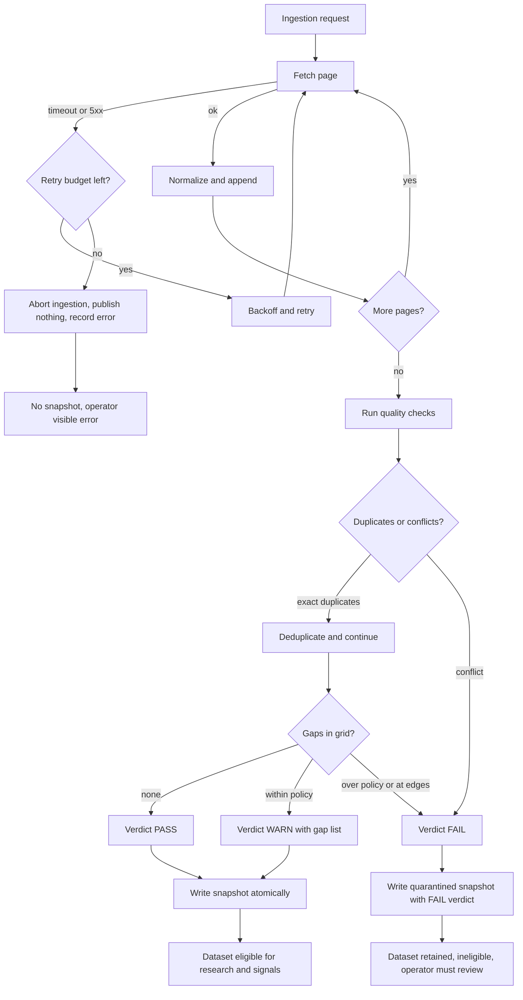

# Data Architecture

The market-data layer is the foundation of every claim the system can make.
If this layer is wrong, nothing above it is trustworthy.

## 1. Lifecycle

```mermaid
flowchart LR
  EX["Public exchange"]
  ING["Ingestion: bounded pagination, rate limit, retries"]
  NORM["Normalization: UTC, schema, ordering"]
  VAL["Validation: OHLC, duplicates, gaps, staleness"]
  RAW["Immutable raw snapshot"]
  CANON["Canonical dataset - Parquet plus manifest"]
  FEAT["Feature computation"]
  REG["Regime analysis"]
  STRAT["Strategy evaluation"]
  SCORE["Scoring and confluence"]
  SIG["Validated signal record"]
  VIEW["Dashboard and API - read only"]

  EX --> ING --> NORM --> VAL
  VAL -->|"PASS or WARN"| RAW
  VAL -->|"FAIL"| QUAR["Quarantine: retained, not usable"]
  RAW --> CANON --> FEAT --> REG --> STRAT --> SCORE --> SIG --> VIEW
```



Key property: the raw snapshot is written **once**. Everything downstream is
derived and reproducible from it.

## 2. Stage contracts

| Stage | Input | Output | Written? | Can fail closed? |
|---|---|---|---|---|
| Fetch | exchange, symbol, timeframe, range | vendor payload pages | No | Yes |
| Normalize | payload pages | typed candle rows | No | Yes |
| Validate | candle rows | `QualityReport` + verdict | No | Yes |
| Persist | candles + manifest | snapshot dir | Yes, once | Yes |
| Load | snapshot id | verified dataframe + manifest | No | Yes |
| Feature | dataframe window | feature frame | Optional cache | Yes |
| Publish | signal record | history entry | Yes, append-only | Yes |

## 3. Timestamp conventions

- All timestamps are timezone-aware UTC (`datetime` with `tz=UTC`;
  pandas `datetime64[ns, UTC]`).
- Naive timestamps are rejected, never assumed to be UTC.
- `open_time` identifies a candle. `close_time = open_time + timeframe`.
- Decision timestamps are explicit: a signal records `generated_at`, the
  dataset id, and the last closed bar it used.
- No local time, no DST handling, no exchange-local strings in storage.
- ISO-8601 with offset in manifests and reports; integer nanoseconds only
  inside Parquet.

## 4. Candle identity and uniqueness

Identity is the tuple:

```text
(exchange, symbol, timeframe, open_time_utc)
```

Rules:

- The tuple is unique within a dataset.
- Sorting is ascending by `open_time`; the loader rejects unsorted data.
- The timeframe and symbol are recorded in the manifest and re-checked on load.
- Two rows with the same identity and identical OHLCV are **duplicates**:
  collapse to one and increment the duplicate counter.
- Two rows with the same identity and **different** OHLCV are **conflicts**:
  reject the batch. Never last-write-wins, never average, never pick one by
  timestamp order.

## 5. Closed-candle-only behaviour

- Ingestion requests only closed candles. The currently forming candle is
  excluded unless an explicit `include_forming` research flag is set.
- A candle is closed when `now_utc >= open_time + timeframe + safety_delay`.
- Signal generation uses only closed candles.
- Backtests read the same immutable dataset; they never observe a forming bar.
- If a dataset somehow contains a forming bar at decision time, the quality
  gate marks it and the signal path abstains.

## 6. Duplicate and conflict handling

| Case | Detection | Action | Recorded |
|---|---|---|---|
| Exact duplicate | Same identity, equal OHLCV | Drop duplicate | `quality.duplicates += 1` |
| Conflicting duplicate | Same identity, different OHLCV | Reject batch | `quality.conflicts`, verdict `FAIL` |
| Overlapping fetch | New range overlaps stored range | Re-fetch only the missing range; re-validate overlap | Provenance range |
| Re-run of identical fetch | Same content hash | Return existing snapshot id; write nothing | No new directory |

## 7. Missing interval detection

- The expected grid is generated from `[start, end]` and the timeframe.
- Every expected `open_time` must be present exactly once.
- Missing points are reported as `Gap(start, end, count)`.
- Gaps are **never** forward-filled, interpolated, back-filled or synthesized.
- Policy:
  - `0` gaps → `PASS`;
  - gaps below `max_gap_bars` and none at the head/tail → `WARN` with details;
  - gaps at the head/tail or above the threshold → `FAIL`.
- A `FAIL` snapshot is retained for forensics but is ineligible for signals
  and for research runs, unless a run explicitly records a `degraded_data`
  acknowledgement.

## 8. OHLC validation

Per row:

- `high >= max(open, close, low)` and `low <= min(open, close, high)`;
- `high >= low`;
- all prices finite and `> 0`;
- `volume >= 0`;
- timestamp strictly inside the requested window;
- timestamp aligned to the timeframe grid (no off-grid bars).

Per dataset:

- no duplicate identity;
- monotonic ascending timestamps;
- no future timestamps relative to fetch time;
- row count is consistent between Parquet and manifest;
- declared dtypes match the schema version.

Any per-row violation makes the batch `FAIL`; a bounded number of warnings may
still be `WARN`.

## 9. Staleness

- Freshness is evaluated at **consumption time**, not only at write time.
- `now_utc - last_closed_open_time` compared against the configured
  `staleness_limit_min` (current default: 90 minutes).
- Stale data yields `NO_TRADE` with `STALE_DATA`; it never yields a synthetic
  fresh value.
- A snapshot written while the market was already stale carries a `WARN` in
  its manifest. That warning is preserved forever; it is evidence.

## 10. Idempotent ingestion

- Snapshot identity is deterministic:

```text
snapshot_id = <exchange>-<symbol-slug>-<timeframe>-<start-stamp>-<end-stamp>-<short>
short = first 12 hex chars of SHA256(exchange|symbol|timeframe|actual_start|actual_end|content_sha256)
```

- The content checksum is computed over the serialized Parquet bytes before
  publication.
- If the target directory already exists:
  - re-verify its checksum and row count;
  - if identical, return the existing id and write nothing;
  - if different, **write a new directory** and leave the old one untouched.
- Publication uses an atomic pattern: write to a temporary sibling directory,
  then rename. A crash leaves no half-published snapshot under a valid id.
- The same fetch executed twice must produce zero new bytes.

## 11. Pagination and rate limiting

- Requests are bounded by `max_pages` and `page_limit` per call.
- `ccxt` rate limiting stays enabled; a single ingestion worker exists per
  process.
- Retries are bounded with exponential backoff and a hard total timeout.
- HTTP 429 honours `Retry-After`; repeated 429 aborts the ingestion.
- Partial pages are never published as a complete snapshot.
- No parallel symbol/timeframe fetching in the baseline; a batch iterates.

## 12. Snapshot manifest

### Schema 1.0 — what actually exists today

Verified from the two snapshots present in `data/processed/binance/BTC-USDT/1h/`:

```json
{
  "snapshot_id": "...",
  "exchange": "binance",
  "symbol": "BTC/USDT",
  "timeframe": "1h",
  "requested_start": "...",
  "requested_end": "...",
  "actual_start": "...",
  "actual_end": "...",
  "fetched_at": "...",
  "row_count": 2209,
  "schema_version": "1.0",
  "columns": { "timestamp": "...", "open": "...", "high": "...", "low": "...", "close": "...", "volume": "..." },
  "quality": { "duplicates": 0, "missing_intervals": 0, "warnings": ["..."] },
  "checksum_sha256": "...",
  "config_hash": "",
  "package_version": "0.1.0"
}
```

`actual_end` is the **open time of the last candle** (inclusive). For example,
2,209 hourly candles cover 2026-07-01T00:00Z through 2026-10-01T00:00Z
inclusive.

### Schema 2.0 — target additions

Additive fields, no removals:

| Field | Purpose |
|---|---|
| `schema_version: "2.0"` | Explicit version |
| `end_inclusive: true` | Removes the current ambiguity |
| `closed_candles_only: true` | Provenance of the causality rule |
| `provenance.source_url` | Exact endpoint |
| `provenance.request_params` | Symbol, timeframe, limit, pagination cursor |
| `provenance.fetched_pages` | Count and byte size |
| `provenance.code_version` | Package version + git commit when available |
| `quality.verdict` | `PASS` / `WARN` / `FAIL` |
| `quality.conflicts` | Conflicting duplicate count |
| `quality.gaps` | List of `{start, end, count}` |
| `quality.checks` | Per-check results with limits |
| `quality.staleness_minutes` | Age at fetch time |
| `dataset_version` | Monotonic per `(exchange, symbol, timeframe)` lineage |
| `previous_snapshot_id` | Lineage link, or null |
| `license` | Vendor terms identifier |

Schema 2.0 is a proposal. Generating it is out of scope for this design task.

## 13. SHA256 integrity

- `checksum_sha256` is the SHA256 of the exact Parquet file bytes.
- It is computed before publication and stored in the manifest.
- Loading recomputes it and refuses to return data on mismatch.
- Row count and dtypes are cross-checked against the manifest.
- Reports record the dataset id **and** its checksum, so a result can be tied
  to bytes, not just a name.
- Model artifacts follow the same rule: `artifact.pkl` checksum is stored in
  `record.json` and verified on load.

Current verified state (2026-11-07):

| Snapshot | Rows | SHA256 | Manifest match |
|---|---|---|---|
| `binance-BTC-USDT-1h-20260701T0000-20261001T0000-103f110e06f0` | 2,209 | `3e3324f2…c5dfb` | Yes |
| `binance-BTC-USDT-1h-20260925T0000-20261028T0000-2cd144f3eb06` | 793 | `90e5339e…123f2d` | Yes |

These are the only two snapshots present in this checkout. A previously
recorded larger research collection is **not** present on disk and is treated
as historical evidence, not as current state.

## 14. Dataset versioning and provenance

Every research run records:

- dataset id and content checksum;
- exchange, symbol, timeframe, start/end;
- quality verdict and warnings;
- feature-set name and version;
- strategy id and version;
- full parameter set (canonicalized, hashed);
- cost model (fee, spread, slippage, funding);
- code version;
- random seed;
- wall-clock start/end and host identifier;
- validation procedure and fold boundaries.

A result whose provenance cannot be reconstructed is not a result.

## 15. Retention and storage layout

```text
data/
  raw/                       optional vendor payloads (immutable)
  processed/
    <exchange>/<symbol-dir>/<timeframe>/
      <snapshot_id>/
        candles.parquet
        manifest.json
  curated/                   optional derived feature datasets (deferred)
  state/                     SQLite WAL transactional state (target)
  paper/                     paper account state
  scheduler/                 scheduler state (target)
```

The role split is normative in `STORAGE_OWNERSHIP.md`: Parquet is canonical for
historical market data, SQLite WAL is canonical for transactional state, and
JSON is canonical for metadata, manifests and provenance. No path carries two
roles.

Retention:

- Snapshots are immutable and are never deleted automatically.
- Deletion is a manual, recorded operator action.
- Derived caches may be deleted and rebuilt at any time.
- Reports are append-only; runs are never overwritten.
- Git ignores `data/`, `models/artifacts/` and `reports/generated/`. A future
  change must also ignore `reports/historical_backtests/`, `data/paper/` and
  `data/scheduler/`; those three are **not** ignored in the current
  `.gitignore`.

## 16. Failure recovery and quality flow



Failure rules:

1. Nothing partial is ever presented as complete.
2. A `FAIL` dataset is evidence, not garbage: keep it, mark it, block it.
3. Recovery is re-running the ingestion; because it is idempotent, a retry
   cannot duplicate data.
4. An operator-visible error always names the symbol, timeframe, range and
   stage that failed.

## 17. Quality verdict state machine

| From | Event | To |
|---|---|---|
| — | All checks pass | `PASS` |
| — | Non-blocking anomaly | `WARN` |
| — | Blocking anomaly | `FAIL` |
| `WARN` | Re-verification finds a blocking anomaly | `FAIL` |
| `FAIL` | Never | Never auto-promoted |

A verdict is immutable once written. Re-validation writes a new audit record;
it does not rewrite history.

## 18. Out of scope for this document

- Actual fetching, normalization code or schema migration.
- Database DDL or migration files.
- Changes to existing snapshots.
