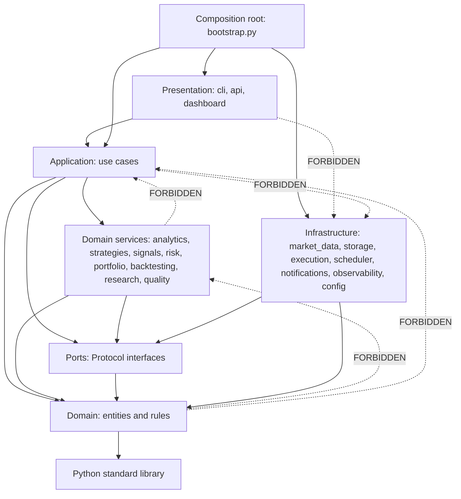

# Dependency Rules

These rules are normative. They exist so the modular monolith stays modular.
They are enforced offline by `tests/unit/test_stage5_architecture.py` (together
with the Stage 0-4 AI/storage suites).

## 1. Dependency direction



Solid arrows are allowed. Dashed arrows are forbidden and are drawn only to
make the prohibition explicit.

## 2. Layer table

| Layer | Package prefix | Allowed imports | Forbidden imports |
|---|---|---|---|
| L0 Domain | `crypto_engine.domain` | stdlib | everything else in the project and all third-party libs |
| L1 Ports | `crypto_engine.ports` | `domain`, stdlib | everything else |
| L2 Domain services | `crypto_engine.{analytics,strategies,signals,risk,portfolio,backtesting,research,quality}` | `domain`, `ports`, stdlib, numeric libs | `application`, `api`, `dashboard`, `cli`, `market_data`, `storage`, `execution`, `scheduler`, `notifications`, `observability`, `config`, `ai`, `bootstrap` |
| L3 Application | `crypto_engine.application` | `domain`, `ports`, L2, pydantic | any concrete infrastructure adapter, presentation |
| L4 Infrastructure | `crypto_engine.{market_data,storage,execution,scheduler,notifications,observability,config,ai}` | `domain`, `ports`, stdlib, third-party libs | `application`, presentation |
| L5 Presentation | `crypto_engine.{cli,api,dashboard}` | `application`, its own DTOs | concrete infrastructure, L2 directly, `bootstrap` except from the entry point |
| Composition | `crypto_engine.bootstrap` | everything | nothing (it is the top) |

Third-party allowance by layer:

| Library | L0 | L1 | L2 | L3 | L4 | L5 |
|---|---|---|---|---|---|---|
| stdlib | yes | yes | yes | yes | yes | yes |
| numpy / pandas / scipy | no | no | yes | yes (types only) | yes | no |
| scikit-learn | no | no | yes (models) | no | no | no |
| pyarrow | no | no | no | no | yes | no |
| ccxt | no | no | no | no | yes | no |
| sqlite3 | no | no | no | no | yes | no |
| pydantic | no | no | optional (schemas) | yes | yes | yes |
| fastapi / uvicorn | no | no | no | no | no | `api` only |
| typer / rich | no | no | no | no | no | `cli` only |
| jinja2 / html | no | no | no | no | no | `dashboard` only |
| provider SDKs (optional) | no | no | no | no | `ai/providers/*` only, lazy | no |

No provider SDK may appear at module import time anywhere. An SDK that is
installed but not enabled must not be imported, and an SDK that is missing must
produce an actionable message naming the install command, never an import-time
crash.

### 2.1 Explicit from/to matrix

Legend: **yes** = allowed; **no** = forbidden; **limited** = value types or
DTOs only, no behaviour; **—** = self.

| From \ To | Domain | Ports | Services | Application | Infrastructure | Presentation | Composition |
|---|---|---|---|---|---|---|---|
| Domain | — | no | no | no | no | no | no |
| Ports | yes | — | no | no | no | no | no |
| Services | yes | yes | — | no | no | no | no |
| Application | yes | yes | yes | — | no | no | no |
| Infrastructure | yes | yes | no | no | — | no | no |
| Presentation | limited | no | no | yes | no | — | yes |
| Composition | yes | yes | yes | yes | yes | yes | — |

The "no" cells are exactly what the architecture tests in §6 enforce.
"Presentation → Composition" is permitted only from the CLI entry point;
API and dashboard modules must not import `bootstrap`.

## 3. Rule list

**DR-1 — Domain purity.** `domain/` imports only the Python standard library.
No pandas, numpy, pydantic, ccxt, sqlite3, fastapi or project module.

**DR-2 — Ports are contracts only.** `ports/` contains only `Protocol`
definitions, `dataclass` DTOs and type aliases. No logic, no I/O, no adapter.

**DR-3 — Domain services do not orchestrate.** L2 modules expose pure
functions/classes over domain values. They do not open files, read settings or
start transactions.

**DR-4 — Application never imports an adapter.** Application depends on port
protocols. Concrete classes are passed in by the composition root.

**DR-5 — Infrastructure never imports application.** Adapters do not call use
cases. When infrastructure must trigger work (e.g. the scheduler), it depends
on a `JobRunner`-style protocol that the composition root binds to an
application function.

**DR-6 — Presentation calls use cases only.** No presentation module imports
`storage/`, `market_data/`, `execution/` or `signals.policy` directly.

**DR-7 — No cycles.** The package graph is a DAG. Any cycle is a build failure.

**DR-8 — Research cannot reach execution.** No module under `research/`,
`backtesting/` or `application/research.py` may import `execution/`,
`portfolio.paper`, the scheduler, or any credential-loading code.

**DR-9 — AI cannot mutate decisions.** No module under `signals/`, `risk/` or
`application/signal*.py` may import an AI provider adapter. AI results enter
as a DTO through a port and are structurally read-only.

**DR-10 — Optional modules are leaves.** `notifications/`, `scheduler/`,
`execution/`, WebSocket ingestion and AI adapters must not be imported by any
core use case. They are constructed only when enabled.

**DR-11 — One writer per storage kind.** Only `storage/` and `market_data/`
touch `data/`. Only `storage/` touches `reports/`. Only `storage/` touches the
model registry directory. Presentation never writes.

**DR-12 — Composition root is unique.** Only `bootstrap.py` and the CLI entry
point may import both application and infrastructure.

**DR-13 — AI is invisible to the decision path.** No module under `domain/`,
`signals/`, `risk/`, `portfolio/`, `backtesting/`, `research/` or
`application/signal*.py` may import `ai/`, `ports/ai.py` or any provider SDK.
AI output reaches them only as an inert value produced before they run, and
never as an input to a decision.

**DR-14 — Provider SDKs are confined and lazy.** A provider SDK may be
imported only inside the adapter module that uses it, inside the function that
performs the call. No module-level SDK import, no SDK type in a public
signature, no SDK object in a DTO.

**DR-15 — One AI entry point.** Only `ai/gateway.py` may call a provider
adapter. Only the composition root may construct the gateway. No other module
may import `ai.providers.*`.

**DR-16 — Registry is data, not code.** The provider/model registry contains no
secret value, no executable code and no embedded credential URL. It is
validated at load and read-only at runtime.

**DR-17 — AI output is stored apart from decisions.** AI responses enter the
system only as port DTOs and are persisted as explanation/usage artifacts keyed
by the related signal or run id. They are never written into canonical signal,
risk or ledger records.

## 4. Permitted and forbidden examples

Permitted:

```python
# application/ingestion.py
from crypto_engine.domain.candles import Candle
from crypto_engine.ports.market_data import MarketDataSource   # protocol
from crypto_engine.ports.snapshots import SnapshotStore         # protocol

def ingest(source: MarketDataSource, store: SnapshotStore, ...) -> ...:
    ...
```

```python
# market_data/binance_rest.py  (infrastructure)
from crypto_engine.domain.candles import Candle
from crypto_engine.ports.market_data import MarketDataSource

class BinanceRestSource:            # satisfies the protocol
    def fetch_ohlcv(self, ...) -> list[Candle]: ...
```

Forbidden:

```python
# domain/risk.py
import pandas as pd  # DR-1 violation
from crypto_engine.storage import SqliteLedger  # DR-1 + direction violation
```

```python
# application/signals.py
from crypto_engine.market_data.binance_rest import BinanceRestSource  # DR-4
```

```python
# dashboard/pages.py
from crypto_engine.storage.sqlite import connect  # DR-6 + DR-11
```

```python
# research/walk_forward.py
from crypto_engine.execution.paper import submit_fill  # DR-8
```

```python
# risk/gates.py
from crypto_engine.ai_providers.openai_adapter import call  # DR-9
```

## 5. Storage ownership

| Path | Sole writer | Readers |
|---|---|---|
| `data/processed/` | `market_data/` + `storage/` | `storage/`, application via port |
| `data/raw/` | `market_data/` | `storage/` |
| `data/state/` | `storage/` | `storage/`, application via port |
| `data/paper/` | `storage/ledger` | `storage/`, application via port |
| `models/artifacts/` | `storage/model_store` | `storage/`, application via port |
| `reports/generated/` | `storage/report_store` | `storage/`, presentation via use case |
| `reports/historical_backtests/` | `storage/report_store` | `storage/` |
| logs | `observability/` | operator |

Storage roles are frozen in `STORAGE_OWNERSHIP.md`: Parquet for historical
market data, SQLite WAL for transactional state, JSON for metadata and
manifests. No path is shared between roles, and no module writes outside its
owned path.

Presentation has read access only through application use cases. It never
opens these paths itself.

## 6. Enforcement

Planned architecture tests (`tests/architecture/`), all offline and fast:

1. **Import graph test** — parse every module with `ast`, build the internal
   import graph, and assert it matches the allowed matrix. One test per rule
   (DR-1 … DR-12), with a readable violation report.
2. **Cycle test** — Tarjan/DFS over the internal graph; fail on any cycle.
3. **Forbidden-symbol test** — assert that `domain/` contains no
   `import pandas|numpy|pydantic|ccxt|sqlite3|fastapi|typer`.
4. **Presentation isolation test** — assert no presentation module imports an
   infrastructure package.
5. **Research isolation test** — assert no research module imports
   `execution`, scheduler or credential loaders.
6. **Port completeness test** — every adapter class declares the port it
   implements and every port has at least one adapter or an explicit
   "unimplemented" marker.
7. **Optional-module test** — assert that removing an optional adapter leaves
   the baseline import graph acyclic and importable.
8. **AI isolation test** — assert no decision-path module imports `ai/`,
   `ports/ai.py` or a provider SDK (DR-13), and that no module outside
   `ai/providers/*` imports a provider SDK (DR-14).
9. **AI entry-point test** — assert `ai.providers.*` is imported only by
   `ai/composition.py`, that `gateway.py`/`registry.py`/`contracts.py` stay
   adapter-free, and that the gateway is constructed only in the composition
   root (DR-15).
10. **Registry hygiene test** — scan the registry for secret-like keys, URLs
    with embedded credentials and executable content (DR-16).

A lightweight implementation uses only `ast` and `pathlib`, so it costs no new
dependency. If a third-party checker is preferred later, that is a separate
decision; it is not assumed here.

## 7. Cross-cutting concerns

| Concern | Allowed access |
|---|---|
| Settings | Injected as a validated object; L0–L2 never read the environment |
| Logging | `observability` configures handlers; other layers use `logging` only |
| Clock | Injected through the `Clock` port; no direct `datetime.now()` in tests |
| IDs | Injected through `IdGenerator`; deterministic in tests |
| Errors | Domain error types; adapters translate external errors into them |

## 8. Why these rules matter here

- Domain purity keeps the rules testable without a venv full of data libraries.
- Port-only application code makes the research path provably free of an
  execution dependency.
- One writer per path prevents the current situation where several modules
  can create directories as a side effect.
- A single composition root keeps optional modules genuinely optional, which
  is what makes the 4 GB envelope achievable.
