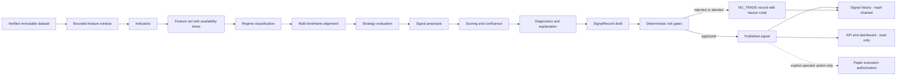

# Module Architecture

This document defines the containers, layers, public ports and use cases of
the target system. It is the reference that `DEPENDENCY_RULES.md` enforces.

## 1. Container / module diagram

```mermaid
flowchart TB
  subgraph PRES["Presentation layer"]
    CLI["cli - typer commands"]
    API["api - FastAPI GET routes"]
    DASH["dashboard - server-rendered HTML"]
  end

  subgraph APPLAYER["Application layer"]
    UC["use cases - orchestration and transactions"]
    DTO["dto - request and response contracts"]
  end

  subgraph SVC["Domain services - pure compute"]
    QUAL["quality"]
    ANALYTICS["analytics - indicators, features, regimes, mtf"]
    STRAT["strategies - registry and built-ins"]
    SIGNALS["signals - scoring, confluence, diagnostics"]
    RISK["risk - deterministic gates and sizing"]
    PORTF["portfolio - ledger rules"]
    BACKTEST["backtesting - event-safe simulation"]
    RESEARCH["research - walk-forward, holdout, robustness"]
  end

  subgraph DOMAIN["Domain layer - stdlib only"]
    ENT["entities and value objects"]
    RULES["invariants, policies, reason codes"]
  end

  subgraph PORTS["Ports layer"]
    PROTO["typing.Protocol interfaces"]
  end

  subgraph INFRA["Infrastructure layer"]
    MKT["market_data - exchange REST, optional WS, normalization"]
    STORE["storage - parquet datasets, sqlite, json stores"]
    EXEC["execution - paper simulator only"]
    SCHED["scheduler - optional in-process jobs"]
    NOTIF["notifications - optional outbound"]
    OBS["observability - logging, health, timings"]
    CONF["config - settings and environment"]
    AIINF["ai - optional gateway, registry, provider adapters"]
  end

  BOOT["bootstrap - composition root"]

  CLI --> UC
  API --> UC
  DASH --> UC
  UC --> DTO
  UC --> QUAL
  UC --> ANALYTICS
  UC --> STRAT
  UC --> SIGNALS
  UC --> RISK
  UC --> PORTF
  UC --> BACKTEST
  UC --> RESEARCH
  UC --> ENT
  UC --> PROTO

  QUAL --> ENT
  ANALYTICS --> ENT
  STRAT --> ENT
  SIGNALS --> ENT
  RISK --> ENT
  PORTF --> ENT
  BACKTEST --> ENT
  RESEARCH --> ENT

  MKT -.->|"implements"| PROTO
  STORE -.->|"implements"| PROTO
  EXEC -.->|"implements"| PROTO
  SCHED -.->|"implements"| PROTO
  NOTIF -.->|"implements"| PROTO
  AIINF -.->|"implements"| PROTO

  BOOT --> CONF
  BOOT --> MKT
  BOOT --> STORE
  BOOT --> EXEC
  BOOT --> AIINF
  BOOT --> UC
  CLI --> BOOT
```

Reading rule: a solid arrow is a compile-time import. A dashed arrow is an
implementation relationship (the adapter satisfies the protocol) and is
resolved only at the composition root. Optional nodes (`PORTF`, `EXEC`,
`SCHED`, `NOTIF`) are reached only by optional use cases and are absent from
the baseline graph.

## 2. Layer responsibilities

### Presentation

| Module | Owns | Must not |
|---|---|---|
| `cli/` | Argument parsing, human-readable output, exit codes, composition-root invocation | Contain strategy, scoring or risk logic; read datasets directly |
| `api/` | HTTP routing, request validation, response envelopes, pagination caps, error sanitization | Mutate state, train, fetch, or import infrastructure adapters |
| `dashboard/` | Server-rendered HTML, escaping, empty/unavailable states | Compute signals, query a database directly, offer trading controls |

Presentation calls **application use cases** and serializes their results.
It never manipulates domain state directly and never reaches into storage.

### Application

Owns orchestration, ordering, transaction boundaries and cross-module
coordination. One use case = one operator intention.

Application may:

- load settings and construct a unit of work through injected ports;
- call multiple domain services in a defined order;
- enforce pre-conditions (e.g. "dataset must be immutable and verified");
- map domain results into DTOs for presentation;
- emit structured log events and timing metrics.

Application may not:

- implement numeric indicator maths (that is `analytics/`);
- implement risk thresholds (that is `risk/` plus domain policy);
- import a concrete adapter;
- contain HTTP, HTML, typer or SQL.

### Domain services (pure compute)

These modules accept domain values and dataframes, and return domain results.
They perform no I/O. They may use `numpy`, `pandas`, `scipy` and
`scikit-learn`; they may not use `ccxt`, `sqlite3`, `fastapi`, `typer` or
filesystem APIs.

| Module | Responsibility |
|---|---|
| `quality/` | Gap detection, OHLC sanity, staleness, duplicate/conflict classification |
| `analytics/indicators/` | Causal technical indicators (returns, ATR, RSI, Bollinger, volume, funding) |
| `analytics/features/` | Feature sets assembled from indicators, with availability timestamps |
| `analytics/regimes/` | Market-regime classification (trend, range, volatility state) |
| `analytics/mtf/` | Multi-timeframe alignment with strict causality |
| `strategies/` | Strategy protocol, registry, metadata, parameter schemas, built-ins |
| `signals/` | Scoring, confluence, diagnostics, reason codes, signal composition |
| `risk/` | Deterministic gate order, position sizing, circuit-breaker inputs |
| `portfolio/` | Ledger invariants, position accounting, equity marks (pure rules) |
| `backtesting/` | Event-safe simulation: next-bar fills, costs, ties, ledger |
| `research/` | Chronological splits, purged walk-forward, holdout, cost stress, robustness |

### Domain

Pure Python: `dataclasses`, `enum`, `datetime`, `decimal`, `typing`,
`collections`. No third-party imports. Contains:

- `Instrument`, `TradingPair`, `Timeframe`, `Candle`;
- `DatasetRef`, `SnapshotManifest` (values, not the file parser);
- `QualityReport`, `Gap`, `QualityIssue`;
- `IndicatorSpec`, `FeatureSet`;
- `Regime`, `RegimeState`;
- `StrategyMetadata`, `StrategyVersion`, `StrategyParameter`;
- `SignalProposal`, `SignalRecord`, `ReasonCode`, `Direction`;
- `ScoreBreakdown`, `ConfluenceResult`, `Diagnostic`;
- `RiskLimits`, `RiskDecision`, `RiskVerdict`;
- `PositionSize`, `Position`, `LedgerEntry`, `EquityPoint`;
- `ResearchRun`, `ValidationResult`, `MetricSet`.

Domain rules are expressed as pure functions or methods and are unit-testable
with no fixtures beyond plain objects.

### Ports

`typing.Protocol` definitions only. No implementations, no adapters, no I/O.
Ports are the dependency-inversion seam. The full list is in §4.

### Infrastructure

Adapters that implement ports. They may import domain types and port
protocols. They are constructed only by the composition root.

### Composition root

`bootstrap.py` is the single place that:

- loads and validates settings;
- selects adapters (REST vs WebSocket; JSON vs SQLite; paper disabled);
- injects adapters into application use cases;
- returns a small container object to presentation.

No other module may import `bootstrap`.

## 3. Use-case catalog

| Use case | Input | Output | Side effects | Ports used |
|---|---|---|---|---|
| `IngestMarketData` | exchange, symbol, timeframe, range | `SnapshotManifest` | Writes immutable snapshot | `MarketDataSource`, `SnapshotStore` |
| `VerifyDataset` | snapshot id | `QualityReport` | None | `SnapshotStore`, `DatasetCatalog` |
| `BuildFeatureSet` | snapshot id, feature spec | `FeatureFrame` (bounded) | Optional curated cache (deferred) | `SnapshotStore` |
| `ClassifyRegime` | feature frame | `RegimeSeries` | None | none |
| `EvaluateStrategies` | features, regime, strategy ids | `SignalProposal[]` | None | none |
| `ScoreAndPublishSignal` | proposals, diagnostics | `SignalRecord` | Appends signal history | `SignalStore`, `Clock` |
| `ApproveSignalRisk` | signal record, portfolio snapshot | `RiskDecision` | None | `RiskStateProvider` |
| `RunBacktest` | dataset, strategy version, costs | `BacktestResult` | Writes run report | `SnapshotStore`, `ReportStore` |
| `RunWalkForward` | dataset, strategy version, fold config | `ValidationResult` | Writes report | `ReportStore` |
| `RunHoldoutEvaluation` | locked holdout, strategy version | `ValidationResult` | Appends holdout ledger | `HoldoutLedger`, `ReportStore` |
| `RunCostStress` | backtest result, cost grid | `RobustnessReport` | Writes report | `ReportStore` |
| `InitPaperAccount` | config, starting equity | `PaperAccount` | Creates ledger file | `LedgerStore` |
| `StepPaperAccount` | one bar, one approved signal | `StepResult` | Mutates paper ledger | `LedgerStore`, `Clock` |
| `FlattenPaperAccount` | mark price | `Trade` record | Mutates paper ledger | `LedgerStore` |
| `ComparePaperToBacktest` | account, frozen backtest | `ComparisonResult` | None | `LedgerStore`, `ReportStore` |
| `BuildHealthReport` | none | `HealthReport` | None | `Clock`, `DatasetCatalog`, `MetadataStore` |
| `PublishReport` | run id | report files + summary | Writes report | `ReportStore` |
| `ListSignals` / `GetSignal` | filters, pagination | page of records | None | `SignalStore` |
| `ListDatasets` / `GetDataset` | filters | manifest page | None | `DatasetCatalog` |
| `GetModelStatus` | none | model metadata page | None | `ModelStore` |

## 4. Port catalog

| Port | Methods (conceptual) | Baseline adapter | Optional adapter |
|---|---|---|---|
| `MarketDataSource` | `fetch_ohlcv`, `fetch_funding` | ccxt REST | public WebSocket |
| `SnapshotStore` | `write`, `read`, `exists`, `checksum` | Parquet + JSON manifest | none |
| `DatasetCatalog` | `list`, `find_latest`, `get` | filesystem scan | SQLite index |
| `MetadataStore` | `get/set instrument`, `record_run` | SQLite WAL (target) | JSON fallback / export |
| `SignalStore` | `append`, `read`, `verify_chain` | JSONL hash chain (append-only audit) | SQLite index |
| `ModelStore` | `save`, `load`, `list`, `verify` | filesystem + checksum | none |
| `ReportStore` | `write_json`, `write_markdown`, `list` | filesystem | none |
| `HoldoutLedger` | `is_pristine`, `record_access` | JSON | SQLite |
| `LedgerStore` | `load`, `save`, `verify` | SQLite WAL (target) | JSON export |
| `Clock` | `now_utc` | system clock | fixed test clock |
| `IdGenerator` | `signal_id`, `run_id` | content hash | deterministic test ids |
| `RiskStateProvider` | `portfolio_snapshot` | ledger reader | none |
| `AiClient` | `generate(task_request)`, `capabilities` | `NullAiClient` (always `disabled`) | gateway + provider adapters |
| `Notifier` | `send` | no-op | webhook / SMTP |
| `ExecutionVenue` | `submit_paper_fill` | paper simulator | **none; live is out of scope** |
| `JobRunner` | `run_job` | in-process | none |
| `UnitOfWork` | `commit`, `rollback` | SQLite txn | file-atomic |

## 5. Production signal flow

Rules visible in the diagram:

- Data must already be verified and immutable before features are built.
- Regime and multi-timeframe stages are mandatory in the target pipeline;
  neither may read a future bar.
- Scoring is deterministic and reproducible from recorded inputs.
- Diagnostics are generated from recorded evidence, never invented.
- The AI context, if enabled, enters only as advisory text attached to
  diagnostics. It has no edge to direction, score or risk.
- Only a risk-approved signal may reach paper execution, and only after a
  separate explicit authorization step.

## 6. Signal, risk and execution are three artifacts

The target separates three decisions that the current code partially
conflates:

| Stage | Produces | Owner | Can be skipped? |
|---|---|---|---|
| Signal generation | `SignalRecord` with direction, score, diagnostics | `strategies/` + `signals/` | No |
| Risk approval | `RiskDecision` referencing the signal id | `risk/` | No |
| Execution authorization | `ExecutionAuthorization` referencing the risk decision | `application/paper.py` | Yes; paper is optional |

A published research signal is stage 1 only. A paper fill requires all three.
There is no fourth stage, because no live venue exists.

`NO_TRADE` may originate at any stage and is always recorded with a reason
code from a closed vocabulary.

## 7. Multi-timeframe analysis

Target behaviour:

- Each timeframe is computed from its own candles; no forward fill across
  timeframes.
- A higher-timeframe value is usable only after that bar has closed.
- Alignment produces, for each base bar, the most recent **closed** value of
  each higher timeframe plus an `available_at` timestamp.
- If a higher timeframe is missing or stale, the alignment returns an explicit
  `unavailable` marker; strategies must abstain rather than guess.
- The set of timeframes is configuration, not hard-coded; the default target
  set is 1h, 4h and 1d, with 15m explicitly deferred for strategy evaluation
  (see `RESEARCH_GOVERNANCE.md`).

## 8. Diagnostics and explanation

Diagnostics answer "why did this signal say what it said?" using only recorded
inputs:

- contributing strategies and their individual directions/scores;
- confluence agreement level and disagreement flags;
- regime at decision time and the rule that produced it;
- indicator values with their `available_at` timestamps;
- risk gate trace (ordered, with pass/fail and reason code);
- data-quality warnings attached to the dataset;
- optional AI context as clearly labelled, non-authoritative text.

Diagnostics never contain prompts, secrets, raw provider payloads or
unrestricted external text.

## 8.1 AI gateway boundary

The optional AI layer is specified in full in `AI_GATEWAY.md`. Three rules are
structural and appear here because they constrain the module graph:

1. The only AI seam is the `AiClient` port in `ports/ai.py`. Callers ask for a
   task; they never name a provider, model, endpoint or credential.
2. `ai/gateway.py` is the only module that calls a provider adapter, and the
   composition root is the only place that constructs it.
3. No domain, signal, risk or portfolio module may import `ai/` or
   `ports/ai.py` (DR-13). AI output is stored as an explanation artifact keyed
   by signal id and is never an input to a decision field.

The laptop orchestrates and normalizes; heavy inference happens at an external
API by default. Local inference is an explicit optional adapter, not the
baseline.

## 9. Composition root and optional modules

`bootstrap.py` decides which optional modules are constructed:

| Module | Default | Enabled by |
|---|---|---|
| SQLite WAL state store | Off in the current code; target default once authorized | `[storage] backend = "sqlite"` |
| WebSocket ingestion | Off | `[data] streaming = true` |
| Paper execution | Off | `sf paper` command + config |
| Scheduler | Off | `sf schedule` command |
| Notifications | Off | `[notifications] enabled = true` |
| AI context | Off | provider enabled in `[ai]` |
| Optional ML family | Off | `[model] default_family` + installed extra |

Disabled means **not constructed**, not "constructed but ignored". A disabled
optional module must not appear in the dependency graph of a baseline use case.

## 10. Failure semantics

| Failure | Behaviour |
|---|---|
| Exchange unreachable | Bounded retries, then explicit error; no partial snapshot is published |
| Schema violation | Reject the batch, record the reason, publish nothing |
| Quality failure | Snapshot may be written only with a `FAILED` quality verdict and is never usable for research |
| Missing higher timeframe | `unavailable` marker; strategies abstain |
| Strategy raises | Isolate to that strategy; record `strategy_error`; other strategies continue |
| Score non-reproducible | Refuse to publish; record a determinism error |
| AI disabled | AI context marked unavailable; decision unchanged |
| AI failed (auth, timeout, rate limit, outage) | Bounded retries; explicit non-ok status; decision unchanged |
| AI output invalid or schema-breaking | Raw text discarded; AI context unavailable; never reported as success |
| Risk gate error | Fail closed: reject |
| Ledger checksum mismatch | Refuse to load; require explicit recovery |
| Report write failure | Non-fatal for the computation; surface as an error with the run id |

## 11. What exists today

Current code has 21 packages directly under `crypto_engine/` and no
`domain/`, `application/`, `ports/` or `bootstrap.py`. Signal generation,
risk gating and CLI orchestration live in `cli.py`, `signals/policy.py` and
`risk/gates.py`. The target modules in this document are proposals; the
mapping and gaps are enumerated in `TARGET_REPOSITORY_STRUCTURE.md`.

Two packages are already implemented rather than proposed: `ai/` (provider-
neutral gateway, Stages 0–5 — see `AI_GATEWAY.md` §24) and `storage/` (role
contracts and enforced-WAL helper — see `STORAGE_OWNERSHIP.md` §9).

## 12. Subsystem contracts

Each row states what the subsystem consumes, produces, owns, depends on, and
does when it fails. Failure handling is fail-closed unless stated otherwise.

| # | Subsystem | Inputs | Outputs | Responsibility | Depends on | On failure |
|---|---|---|---|---|---|---|
| 1 | Exchange adapters | Symbol, timeframe, range, params | Raw OHLCV/funding pages | Public REST/WS access, rate limit, bounded retries | `MarketDataSource` port | Typed error after bounded retries; no partial publish |
| 2 | Market-data ingestion | Request + adapter | Normalized candles + provenance | Paginate, deduplicate, idempotent write | Adapter, quality, storage | Abort; name symbol, timeframe, range, stage |
| 3 | Candle normalization | Raw rows | Typed UTC candles | Schema, timezone, ordering, dtypes | `domain/candles` | Reject the batch |
| 4 | Data-quality engine | Candles + expected grid | `QualityReport` + verdict | OHLC, gaps, duplicates, conflicts, staleness | `domain/quality` | `FAIL` verdict; quarantine, never usable |
| 5 | Historical data storage | Candles + manifest | Immutable snapshot dir | Atomic write, checksum, verified read | `SnapshotStore` port | Clean temp dir; publish nothing |
| 6 | Indicator engine | Candle window + spec | Indicator columns + `available_at` | Causal computation | Domain, numpy/pandas | Raise; caller abstains; never fill forward |
| 7 | Market-regime classifier | Feature frame | `RegimeSeries` | Deterministic regime rules | `analytics/features` | `unknown` regime; strategies abstain |
| 8 | Strategy registry and engine | Features, regime, MTF, metadata | `SignalProposal[]` | Registry, versioning, evaluation | `domain/strategies` | Isolate `strategy_error`; other strategies continue |
| 9 | Multi-timeframe analysis | Series for several timeframes | Closed values + `available_at` | Strict causal alignment | `analytics` | `unavailable` marker; abstain |
| 10 | Signal scoring and confluence | Proposals + weights | Score + confluence result | Deterministic combination | `domain/scoring` | Refuse to publish on non-reproducible result |
| 11 | Signal diagnostics | Contributions, regime, quality | Diagnostics block | Explain the signal from recorded evidence | `signals/scoring` | Refuse to publish if mandatory diagnostics are missing |
| 12 | Risk management | Signal + portfolio snapshot + limits | `RiskDecision` + gate trace | Fixed gate order; deterministic; model/AI cannot override | `domain/risk` | Error means reject |
| 13 | Portfolio management | Fills, marks, costs | Ledger, equity points | Accounting invariants | `domain/portfolio` | Checksum mismatch means halt |
| 14 | Paper execution simulator | Approved signal + authorization + bar | Hypothetical fill | Simulate with explicit costs; no live venue | `portfolio`, `ExecutionVenue` | Reject or no-op; record reason |
| 15 | Research/backtesting engine | Dataset, strategy version, costs | `BacktestResult` | Event-safe simulation, next-bar fills, ties | `backtesting`, `research` | Abort with cause; no partial result |
| 16 | Walk-forward and robustness | Dataset, folds, cost grid | `ValidationResult`, report | Purge/embargo, holdout, cost stress | `research` | Refuse non-pristine holdout; verdict `inconclusive` |
| 17 | Reporting | Run artifacts | JSON + Markdown report | Provenance, metrics, verdict, limitations | `ReportStore` | Non-fatal; surface error with run id |
| 18 | Scheduler and automation | Schedule + job id | Job invocation | Single-process, sequential, recorded runs | `JobRunner` port | Record missed run; no burst catch-up |
| 19 | REST API | HTTP GET | JSON envelope | Read-only, bounded, sanitized | Application queries | Sanitized 4xx/5xx; no internals |
| 20 | Dashboard | HTTP GET | HTML | Render recorded evidence; explicit empty states | Application queries | Explicit unavailable state, never fabricated rows |
| 21 | Notifications | Event | Outbound message | Optional alerting | `Notifier` port | Log and continue; never block a signal |
| 22 | System health and observability | Component probes | Health report, logs, timings | Liveness, config, storage, dataset checks | Ports | Report degraded; never mutate |
