# Research Governance

Research is the product. Execution is optional. This document defines how
evidence is produced, how it is protected from contamination, and how a
strategy could ever be promoted.

## 1. Governing principles

1. **Causality.** Only information available at the decision timestamp may be
   used. A close-based decision executes no earlier than the next bar.
2. **No forced targets.** Never optimize toward a mandated accuracy. Report
   negative and inconclusive evidence honestly.
3. **Separation of exploration and confirmation.** In-sample tuning and
   locked out-of-sample validation are different activities with different
   rules.
4. **Holdout sanctity.** The final holdout is opened once per strategy
   version, with an access record.
5. **Cost realism.** Fees, spread, slippage and applicable funding are always
   modelled. A gross-profit result is not a result.
6. **Abstention is valid.** `NO_TRADE` is an expected output, not a bug.
7. **No promotion by backtest.** A good backtest is a hypothesis, not
   approval.

## 2. Isolated research path

```mermaid
flowchart LR
  DS["Immutable dataset with checksum"] --> SPLIT["Chronological split"]
  SPLIT --> TRAIN["Train window"]
  SPLIT --> VAL["Validation window with purge and embargo"]
  SPLIT --> HOLD["Locked final holdout"]
  TRAIN --> FIT["Fit or parameterize strategy"]
  FIT --> WF["Purged walk-forward folds"]
  VAL --> WF
  WF --> METRICS["Fold metrics and stability"]
  METRICS --> STRESS["Cost stress and sensitivity"]
  STRESS --> ROBUST["Robustness verdict"]
  ROBUST -->|"passes prespecified criteria"| HOLDOUT["Single holdout evaluation"]
  HOLD --> HOLDOUT
  HOLDOUT --> REPORT["Research report and conclusion"]
  REPORT -->|"never automatic"| REVIEW["Promotion review by operator"]
  REVIEW -->|"explicit approval only"| PROD["Candidate for production eligibility"]
  ROBUST -->|"fails"| REJECT["Rejected - recorded, not deleted"]
```

The research path has **no edge** to order submission, the paper ledger, the
scheduler mutation API, or credential loading. This is enforced structurally
(see `DEPENDENCY_RULES.md` DR-8), not by convention.

## 3. Research vs production

| Dimension | Research path | Production signal path |
|---|---|---|
| Input | Immutable historical dataset | Verified recent dataset |
| Time | Historical, replayable | Current, one closed bar at a time |
| Strategy state | Experimental adapters allowed | Only promoted, versioned strategies |
| Output | Report, metrics, verdict | `SignalRecord` |
| Orders | Never | Never (paper only, and only with explicit authorization) |
| Mutation of live state | None | Signal history append only |
| Reproducibility | Required: dataset hash, params, code version, seed | Required: same, plus input snapshot id |

A strategy object may be shared between the two paths only if it is pure and
carries an explicit version. The research path may not write to production
state.

## 4. Validation protocol

Mandatory sequence for any candidate:

1. **Pre-registration.** State hypothesis, target, horizon, baseline, feature
   availability times, sample size, cost model and validation procedure
   *before* looking at results.
2. **Chronological split.** Train / validation / holdout by time. No random
   shuffling across time.
3. **Purge and embargo.** Drop training rows whose label horizon overlaps the
   validation window; add an embargo gap.
4. **Walk-forward.** Multiple folds, fixed windows, recorded boundaries.
5. **Cost stress.** Re-run with higher fees, spread and slippage; report the
   break-even cost.
6. **Robustness.** Parameter sensitivity, regime breakdown, symbol/timeframe
   breakdown, trade-count sufficiency.
7. **Holdout.** One evaluation, recorded in the holdout ledger, after the
   strategy version is frozen.
8. **Conclusion.** Explicit `supported` / `not supported` / `inconclusive`.

Validation-period gains never substitute for holdout evidence.

## 5. Cost model

Every backtest and paper comparison uses an explicit `CostModel`:

| Leg | Unit | Notes |
|---|---|---|
| Fee | basis points per side | Taker/maker distinction where modelled |
| Spread | basis points | Half-spread applied per side |
| Slippage | basis points | Explicit, not implicit in fill price |
| Funding | per-bar rate | Side- and regime-aware where data exists |

A result that omits any applicable leg is labelled incomplete. Stress runs
must at minimum double the baseline cost and report the outcome.

## 6. Metrics discipline

- **Accuracy**: fraction of predictions correct. Not a trading result.
- **Win rate**: fraction of trades with positive gross P&L unless costs are
  explicitly included.
- **Profitability**: net P&L after all costs, only claimable with valid
  out-of-sample support.
- **Coverage / abstention rate**: how often the strategy declines to act.
- **Stability**: dispersion across folds, not just the mean.

Never report a single aggregate that hides a negative fold. Never select the
best fold as the result.

## 7. Anti-overfitting controls

- Fixed seeds and recorded parameter grids.
- Trial counting in the experiment registry; multiple-comparison correction
  (Holm/Bonferroni or a documented equivalent).
- Deflated Sharpe or an equivalent adjustment when many trials are run.
- No metric-driven threshold changes after holdout access.
- No feature selection on the holdout.
- Suspiciously good results trigger investigation, not celebration.

## 8. Promotion review

A strategy becomes **production-eligible** only through this process. It is a
human decision, not a pipeline output.

### Eligibility gates (all required)

| Gate | Requirement |
|---|---|
| G1 Reproducibility | Report reproduces from dataset hash + parameters + code version |
| G2 Causality | Leakage tests pass; no future information in features |
| G3 Out-of-sample | Holdout evaluation is positive net of stress costs |
| G4 Robustness | Not dependent on one fold, one regime or one parameter point |
| G5 Cost realism | Break-even cost is above realistic trading cost |
| G6 Sample sufficiency | Enough independent trades/bars to be meaningful |
| G7 Stability | No unexplained degradation across time |
| G8 Documentation | Hypothesis, limits and failure modes written down |
| G9 Independent review | A read-only reviewer reproduces the result |
| G10 Human authorization | Operator explicitly approves and records it |

### Explicit non-gates

The following do **not** promote a strategy:

- a good in-sample result;
- a single profitable fold;
- a high accuracy figure;
- a convincing narrative;
- an AI explanation;
- a backtest that beat a weak baseline by a small margin.

### Demotion

A promoted strategy is demoted if monitoring shows a drift beyond its
documented tolerance, a reproduced defect, or a data-quality failure in its
input lineage. Demotion is recorded and does not delete history.

## 9. Historical research findings

> **HISTORICAL — NOT VERIFIED CURRENT FILESYSTEM EVIDENCE.**
>
> The following statements record a prior research cycle. The datasets, run
> directories and scripts that produced them are **not present** in this
> checkout. They must not be cited as current artifacts, nor re-used as
> evidence without re-running the work.

- A prior cycle evaluated BTC, ETH, SOL, BNB and XRP.
- It evaluated 1h, 4h and 1d performance. 15m strategy performance was
  deferred.
- **No strategy demonstrated sufficient out-of-sample evidence.**
- The recorded conclusion was `candidates_for_paper_testing = []`.
- Walk-forward validation and cost stress were treated as mandatory.
- Validation-period gains did not substitute for holdout evidence.
- Sparse indicator values were not forward-filled or fabricated.
- Backtests modelled fees, slippage and applicable market mechanics.
- Thresholds were not weakened to promote a strategy.

These are governance facts about how the project behaves. They are preserved
here so a rebuild cannot quietly forget them or relabel a negative result as a
positive one.

## 10. Current status of evidence

| Claim | Status |
|---|---|
| A profitable strategy exists | **No evidence.** Treat as false until proven out of sample. |
| `candidates_for_paper_testing = []` | Historical conclusion; unchanged and still the effective position. |
| Phase 10 forward validation | Frozen-model validation only; recorded in project memory; not a promotion. |
| Any strategy promoted | None. |

## 11. Reporting requirements

Every research report must contain:

1. Run id, timestamp, code version.
2. Dataset ids and checksums.
3. Strategy id/version and full parameters.
4. Fold boundaries and sample counts.
5. Cost model and stress grid.
6. Metrics per fold and aggregate, with dispersion.
7. Holdout result and access record, or "not opened".
8. Verdict and explicit limitations.
9. Reproduction command.

A report missing any of these is marked incomplete.

## 12. Roles

| Role | May | May not |
|---|---|---|
| Researcher | Design hypotheses, run research, write reports | Promote, place orders, alter holdout records |
| Reviewer | Reproduce and challenge evidence | Promote on their own |
| Operator | Authorize promotion, authorize paper runs | Fabricate evidence |
| AI provider | Return advisory text | Influence direction, score, risk or promotion |

## 13. What this document does not do

It does not run anything, change any current result, or promote any strategy.
It defines the rules a future implementation must satisfy.
