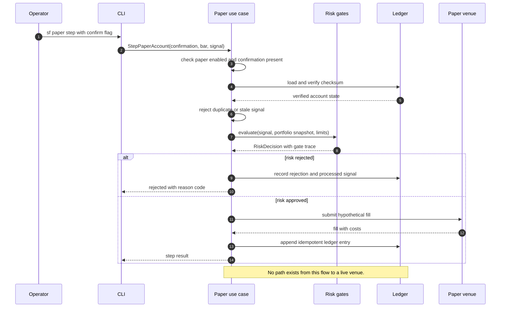

# Security and Execution Boundaries

This document defines what the system may do, what it must refuse to do, and
where the enforcement points are. It extends `docs/SECURITY.md`; it does not
replace it.

## 1. Posture in one paragraph

SignalForge is a **read-only, research-first** system. Market data is public.
No order can be placed. Paper simulation exists only as an explicitly enabled
local sandbox with hypothetical fills. The API and dashboard are GET-only and
bind to loopback by default. Secrets live only in the environment. Every
mutating action requires a local process invocation by the operator, and every
mutation is recorded.

## 2. Trust zones

| Zone | Contents | Trust | Enforcement |
|---|---|---|---|
| Z0 Local operator | CLI invocation, config edits | Trusted | Filesystem permissions |
| Z1 Application process | Domain, application, in-memory state | Trusted | Import rules, tests |
| Z2 Local artifacts | Snapshots, ledgers, reports, models | Semi-trusted | Checksums, path confinement |
| Z3 Localhost HTTP | API and dashboard clients | Untrusted | GET-only, validation, sanitization |
| Z4 Public network | Exchange, AI providers | Untrusted | Schema validation, timeouts, bounds |
| Z5 Remote network | Any non-loopback client | Denied by default | Bind enforcement |

## 3. Read-only default operation

- The server mode exposes only GET routes. The route table is asserted at
  build time: any non-GET, non-docs route aborts startup.
- Dashboard forms and buttons that would mutate state do not exist. There is
  no "run", "train", "fetch", "trade" or "reset" control.
- The API does not expose training, fetching, backtesting or paper stepping.
- CLI read commands (`health`, `config-show`, `data status`, `signal history`,
  `model list`, `paper status`, `paper verify`) never mutate.
- Any command that writes requires an explicit subcommand, and destructive
  actions require an additional confirmation flag.

## 4. Paper execution is disabled by default

| Control | Default | Enabling requires |
|---|---|---|
| Paper module constructed | No | `sf paper` command |
| Account file | Must be created with `sf paper init` | Explicit command |
| Paper step | Refuses without an existing verified account | Explicit command |
| Paper step with confirmation | Required for any action that opens or closes a position | `--confirm` flag |
| Paper in server mode | Never exposed | No route exists |
| Paper in scheduler | Off | Explicit config + command |

"Disabled" means the module is not constructed, not merely inert.

## 5. Confirmation model

A paper action is authorized only when all of the following hold:

1. Paper is enabled in configuration.
2. The account file exists and its checksum verifies.
3. The operator supplied the explicit confirmation flag for the action.
4. The signal is not a duplicate and not stale.
5. The deterministic risk gates approve it against a real portfolio snapshot.
6. The system is not halted.

Failure of any condition produces a recorded rejection and no state change
beyond the rejection record.

## 6. Separation of the three decisions

| Decision | Artifact | Producer | Can be overridden by |
|---|---|---|---|
| Signal generation | `SignalRecord` (direction, score, diagnostics) | Strategies + scoring | Nothing; regenerated only by re-running |
| Risk approval | `RiskDecision` (approved/rejected, reason, limits) | Deterministic gates | Nothing; AI and models cannot override |
| Execution authorization | `ExecutionAuthorization` (paper only) | Operator command + use case | Revoked by halt or integrity failure |

A dashboard view may display all three. It may not create any of them.

## 7. Pre-trade risk checks

Order of evaluation is fixed and auditable:

1. Data freshness and dataset verdict.
2. Signal schema and completeness.
3. Signal age and horizon validity.
4. Model/strategy artifact validity.
5. Calibration validity (if applicable).
6. Direction allow-list.
7. Strategy disagreement threshold.
8. Expected edge versus cost.
9. Per-trade risk.
10. Position size.
11. Portfolio exposure.
12. Drawdown / kill switch.

The first failure rejects and records its reason code. Passing checks never
modify the signal. Errors fail closed.

## 8. Limits

Current configured defaults (from `config/default.toml`, still the source of
truth for current code):

| Limit | Default |
|---|---|
| Max risk per trade | 1.0% of equity |
| Max position size | 10.0% of equity |
| Max drawdown (kill switch) | 5.0% |
| Fail closed on gate error | true |
| Risk gates enabled | true |
| Max holding bars | 24 |
| Max backtest bars | 5,000 |

Target additions (proposed, not implemented):

| Limit | Purpose |
|---|---|
| Max gross exposure | Prevent stacking correlated positions |
| Max open positions | Bound ledger and memory |
| Max daily loss | Intraday circuit breaker |
| Max symbol concentration | Avoid single-asset dependence |
| Max signal rate | Throttle burst publication |
| Max paper notional | Bound simulated exposure |

Limits are configuration, validated at load, and recorded in every decision.

## 9. Circuit breakers

| Trigger | Action | Recovery |
|---|---|---|
| Drawdown exceeds limit | Halt new positions; mark open positions | Operator reset, recorded |
| Dataset verdict `FAIL` | Block signals and research | Operator review |
| Staleness beyond limit | `NO_TRADE`, block paper entry | Fresh data |
| Ledger checksum mismatch | Refuse load, halt | Explicit recovery |
| Repeated gate errors | Halt, surface error | Investigate, reset |
| Clock skew above tolerance | Halt time-sensitive actions | Fix clock |
| Cost model missing a leg | Block profitability claims | Complete the model |

A circuit breaker never silently resumes. Recovery is an explicit, recorded
operator action.

## 10. Idempotency

- Every signal has a deterministic id derived from content and timestamp.
- Every paper step consumes at most one bar and at most one signal.
- Processed signal ids are recorded on both accept and reject.
- Ledger entries carry stable ids; re-applying an entry is a no-op.
- Account files carry a checksum; a corrupt file is rejected, not repaired
  silently.
- Re-running an ingestion with identical content produces no new snapshot.

## 11. No live execution

There is no live-order adapter in the target architecture. Not deferred behind
a flag, not stubbed, not imported conditionally: **absent**.

Specifically absent:

- order submission, amendment, cancellation;
- private exchange endpoints;
- API-key loading for trading;
- balances, deposits, withdrawals, transfers;
- leverage, margin, liquidation handling;
- custody or wallet interaction;
- account management of any kind.

Adding any of these requires a separate architecture decision, a security
review and an explicit phase authorization. It is not a configuration change.

## 12. Network binding

| Mode | Bind | Remote allowed |
|---|---|---|
| `sf serve` default | `127.0.0.1` | No |
| `sf serve --allow-remote` | Explicit address | Yes, with warning |
| Ingestion | Outbound HTTPS only | N/A |
| AI providers | Outbound HTTPS only, opt-in | N/A |
| Notifications | Outbound HTTPS only, opt-in | N/A |

Non-loopback binding is refused unless explicitly requested. There is no
wildcard CORS with credentials; CORS is deny-by-default with an explicit
origin allow-list.

## 13. Secrets

- Secrets live only in environment variables or a git-ignored `.env`.
- `config/default.toml` contains no secrets; it never will.
- Logs redact known secret patterns; error responses never include env values,
  paths or tracebacks.
- The signal audit history rejects secret-like field names on append.
- Provider keys are read at call time, never persisted.
- No secret is written into reports, signals, datasets or model artifacts.

### 13.1 AI secret boundary

AI credentials follow the same rules and add two constraints: the provider
registry stores only the **environment variable name**, never a value, and an
adapter reads the value at call time. In the target, keys are never placed in a
URL, a registry file, a report or an error. The current Gemini adapter is a
recorded exception (the vendor API requires a query parameter); it is a
residual risk, not a pattern to copy. The full boundary is specified in
`AI_GATEWAY.md` §10.

## 14. API and dashboard controls

| Control | Rule |
|---|---|
| Methods | GET only; build-time assertion |
| Paths | Validated identifiers; traversal blocked; confinement to allowed roots |
| Pagination | Default 50, hard cap 500 |
| Scans | Bounded line/row counts |
| Errors | Sanitized; request id for correlation; no internals |
| HTML | All dynamic content escaped; no raw model/AI HTML or JS |
| Caching | No shared cache; no credentials |
| Auth | None by design because there is no remote exposure; remote mode requires a documented compensating control before use |
| Docs routes | Framework-provided only; no write surface |

## 15. Audit trail

Recorded, append-only:

- every signal published, with inputs and reason codes;
- every risk decision, with the full gate trace;
- every paper action, with confirmation evidence;
- every snapshot creation, with checksum and quality verdict;
- every research run, with dataset hashes and parameters;
- every holdout access;
- every halt and reset.

The signal history is hash-chained: each entry includes the previous entry
hash, so tampering is detectable.

## 16. Paper execution safety flow

## 17. Threat model

| Threat | Vector | Impact | Control |
|---|---|---|---|
| Malicious exchange payload | Public API | Corrupt data, wrong signals | Schema, OHLC, UTC and gap validation; quarantine |
| Prompt injection via news/macro text | AI provider input | Manipulated explanation | Constant task string, data-wrapped evidence, closed output schema, no authority |
| Path traversal | API identifiers | File disclosure | Identifier validation, root confinement |
| Secret leakage | Logs, errors, reports | Credential exposure | Redaction, env-only storage, tests |
| Accidental remote exposure | `sf serve` bind | Unauthorized read | Loopback default, explicit opt-in |
| Runaway ingestion | Unbounded pagination | Memory exhaustion, rate ban | Page caps, one worker, bounded retries |
| Corrupt ledger | Partial write / tamper | False P&L | Atomic write, checksum, refuse-to-load |
| Replayed signal | Duplicate id | Double position | Processed-id ledger, idempotent step |
| Dependency compromise | Third-party package | Arbitrary code | Minimal deps, pinned lockfile, no auto-update |
| Model artifact tampering | Local pickle | Code execution | Checksum verification, trusted-local-only policy |
| Overfit promotion | Research process | False confidence | Holdout ledger, promotion gates, human authorization |
| SSRF via custom AI endpoint | Operator-configured base URL | Internal network access | Absolute-URL validation, egress allowlist, no redirects |
| AI cost runaway | Loops, retries, large prompts | Unexpected spend | Pre-call budgets, concurrency 1, bounded retries and input size |
| AI output injection into UI | Model text containing HTML/JS | XSS | Escaped rendering, plain text only, no raw AI HTML |

## 18. Incident response

1. Halt the affected subsystem (paper, scheduler, ingestion).
2. Preserve artifacts; do not delete evidence.
3. Record the failure with the run id and reason code.
4. Reproduce before fixing.
5. Report severity, evidence and remediation in the handoff.
6. Never hide an unresolved risk.

## 19. What this document does not authorize

It does not enable paper trading, create an account, run a backtest, start a
server, or change any setting. It defines boundaries for a future
implementation that requires separate approval.
