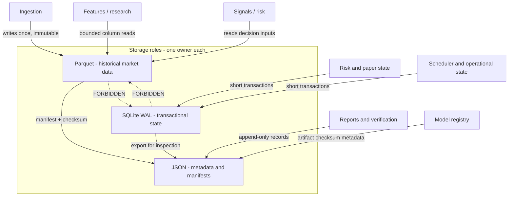
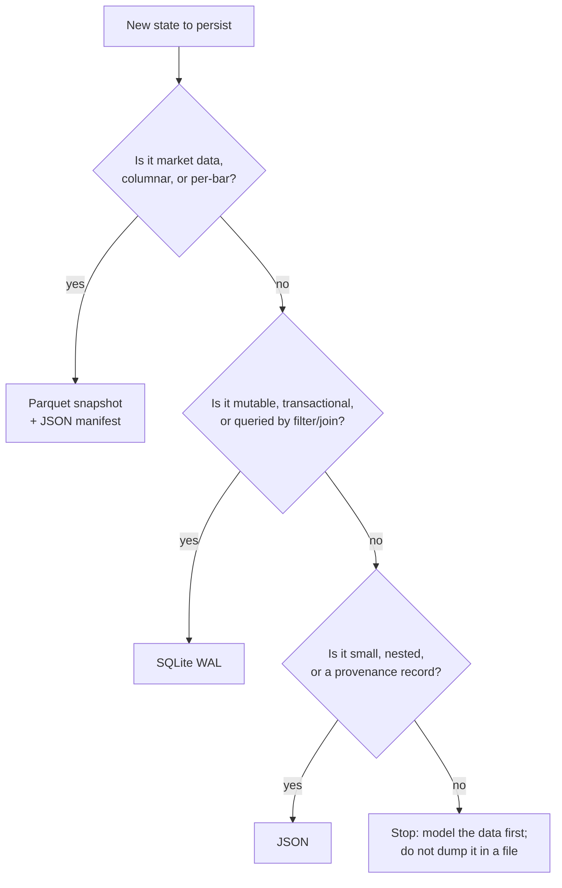

# Storage Ownership — Parquet, SQLite WAL, JSON

**Status: ARCHITECTURE FREEZE — role contracts implemented in
`src/crypto_engine/storage/` (Stage 0, 2026-11-07).**

This document freezes the storage architecture. Stage 0 implements the role
contracts, the SQLite-WAL helper and the deterministic JSON store; it creates
no database file, no migration and no schema migration. `data/state/` does not
exist today. `sqlite3` is imported only by
`src/crypto_engine/storage/sqlite.py`; market-data modules never import it.

Authorization: `AGENTS.md` authorizes Phase 10 only and excludes architecture
rewrites. This is documentation produced for review. Implementation requires
explicit user approval recorded before the first line of code.

---

## 1. The three storage roles

SignalForge has three genuinely different kinds of state, and they must not be
mixed.

| Role | Technology | Canonical for | Must never hold |
|---|---|---|---|
| **Historical market data** | Parquet + JSON manifest | OHLCV, funding, derived research datasets, immutable snapshots | transactional state, mutable counters |
| **Transactional application state** | SQLite in WAL mode | portfolio, positions, paper trades, ledger, scheduler jobs and events, operational state | bulk candles, large columnar data |
| **Metadata / manifests / research metadata** | JSON | dataset manifests, provenance, SHA256, validation metadata, research metadata, model metadata, verification records, configuration metadata | large market datasets, per-row transactional state |



The two `FORBIDDEN` edges are the decision: candles never go into SQLite, and
transactional state never goes into Parquet.

## 2. Parquet — historical market data

### 2.1 What belongs

- Raw and processed OHLCV snapshots (BTC/USDT, ETH/USDT, any symbol/timeframe).
- Funding-rate series and other columnar market data.
- Optional derived research datasets (curated feature sets), when an authorized
  phase builds them.

### 2.2 Canonical identity

```text
exchange + symbol + timeframe + open_time_utc
```

Rules (unchanged from `DATA_ARCHITECTURE.md`):

- the tuple is unique within a dataset;
- rows are sorted ascending by `open_time`;
- exact duplicates are collapsed and counted;
- conflicting duplicates reject the batch — never last-write-wins;
- timestamps are timezone-aware UTC; naive timestamps are rejected;
- gaps are reported, never filled.

### 2.3 Layout

```text
data/processed/<exchange>/<symbol-dir>/<timeframe>/<snapshot_id>/
  candles.parquet      # columnar rows
  manifest.json        # provenance, row count, quality, checksum
```

### 2.4 Immutability and replacement

- A published snapshot is immutable. Its directory is never edited in place.
- Loading recomputes the SHA256 of the Parquet bytes and refuses on mismatch.
- Row count and dtypes are cross-checked against the manifest.
- Re-running an identical fetch returns the existing snapshot id and writes
  nothing.
- **Replacement workflow (the only permitted way to change published data):**
  1. the original snapshot is retained, never deleted;
  2. a new snapshot is written with a new id and a new checksum;
  3. the new manifest records `replaces_snapshot_id`, the reason and the
     operator;
  4. the old manifest is not rewritten; lineage is followed forward;
  5. reports citing the old id remain valid for the old bytes.

### 2.5 Access rules (4 GB envelope)

- Project columns at read time; never read a wide frame for a narrow question.
- Prefer row-group iteration for large files.
- One symbol and one timeframe in memory at a time by default.
- No full-matrix copies; no unbounded generator materialized into a list.
- Cap row counts explicitly and record the cap when it applies.

### 2.6 Why not SQLite for candles

| Reason | Detail |
|---|---|
| Columnar scans | Analytics reads a few columns across many rows; SQLite reads rows |
| Dataset portability | A snapshot directory is a citable, copyable artifact |
| Immutability | A file plus checksum is easier to freeze than a mutated table |
| Migration burden | Schema changes become database migrations instead of new snapshot lineages |
| Bloat | A candle table with indexes competes for the same 4 GB budget |

A SQLite **index** of snapshots is permitted later as a cache, but it is never
the source of truth (ADR-0004).

## 3. SQLite WAL — transactional application state

### 3.1 What belongs

- Portfolio state and positions.
- Paper trades and the paper ledger.
- Signal index (id, timestamp, status) if a query pattern requires joins.
- Scheduler jobs, job runs and scheduler events.
- Operational state: circuit-breaker state, last-run markers, processed ids,
  idempotency keys.
- AI usage records (see §6), if the explanation artifact choice lands here.

### 3.2 Required PRAGMAs

Every connection opens with the same explicit configuration:

```sql
PRAGMA journal_mode = WAL;        -- write-ahead logging, readers do not block the writer
PRAGMA synchronous = NORMAL;      -- durability/throughput balance; ledger writes may use FULL
PRAGMA busy_timeout = 5000;       -- bounded wait instead of immediate SQLITE_BUSY
PRAGMA foreign_keys = ON;         -- enforce referential integrity
PRAGMA temp_store = MEMORY;       -- avoid temp files on constrained disks
```

Notes:

- `journal_mode = WAL` is persistent in the database file; it must still be
  asserted on open so a copied file cannot silently revert.
- `synchronous = NORMAL` is the default. A ledger-critical write may escalate
  to `FULL` for that transaction and must record that it did.
- WAL creates `-wal` and `-shm` sidecar files. They are part of the database
  state and must be handled by backup and by `.gitignore`.
- `temp_store = MEMORY` is safe only because transactional queries are bounded
  (small tables, explicit limits). No large sort or join may run against this
  database; analytics belongs on Parquet.

### 3.3 Concurrency and locking

| Rule | Reason |
|---|---|
| Exactly one writer process | The application is single-process by design |
| Short transactions only | Long transactions block checkpoints and grow the WAL |
| No transaction held across a network call | A timeout would hold a lock indefinitely |
| No long-held file locks | OneDrive-safe: no lock while the sync client scans |
| `busy_timeout` bounded | Fail with an actionable error, do not hang |
| Checkpoint on clean shutdown | Keep the WAL small; `TRUNCATE` checkpoint when idle |

### 3.4 Filesystem constraint (Windows / OneDrive)

WAL mode requires shared-memory support and a local filesystem. It is not safe
on a network share or on a folder where a sync client may copy or replace the
database mid-transaction.

Therefore:

- the database lives under `data/state/` on a **local** disk;
- if the repository is inside a synchronised folder, `data/state/` must be
  excluded from sync, or the SQLite backend is not enabled;
- the fallback is the current JSON state files, with the limitation recorded —
  never a silently degraded database;
- no database file is ever committed.

### 3.5 Schema discipline

- A `schema_version` table records the applied version.
- Migrations are ordered, idempotent and run inside a transaction.
- A migration that cannot complete rolls back and refuses to start the
  application rather than running on a half-migrated schema.
- No ORM is required; `sqlite3` from the standard library is sufficient and
  adds no dependency.
- Every table documents its owner module and its retention rule.

### 3.6 Backup and recovery

- Backup after a checkpoint, using `VACUUM INTO` or a file copy of the
  database plus any remaining WAL sidecar files.
- A backup is verified by opening it read-only and checking
  `PRAGMA integrity_check` and the schema version.
- Recovery is explicit. A corrupt database is never "repaired" silently and
  never replaced by an empty one.
- JSON export of critical tables is available for inspection and for disaster
  recovery; the export is a copy, not the source of truth.

## 4. JSON — metadata, manifests and research metadata

### 4.1 What belongs

| Kind | Examples |
|---|---|
| Dataset manifests | snapshot id, exchange, symbol, timeframe, range, row count, checksum, quality verdict |
| Provenance | source URL, request parameters, fetch time, code version |
| Integrity metadata | SHA256 values, artifact checksums, verification records |
| Validation metadata | split boundaries, purge/embargo, fold results, verdicts |
| Research metadata | hypothesis, parameters, cost model, seed, conclusion |
| Append-only audit and history | signal history (hash chain), experiment registry, holdout ledger, verification records |
| Model metadata | model id, family, label hash, checksum, calibration state |
| Configuration metadata | non-secret settings snapshots used by a run |
| AI metadata | provider/model/route/status/usage records (never prompts or keys) |

### 4.2 Rules

- UTF-8, ISO-8601 UTC timestamps with offset.
- Canonical key ordering when a document is hashed; the hash is recorded.
- Atomic write: temp file then rename, so a crash leaves no half-written
  manifest.
- A `schema_version` field on every structured document.
- Secrets are forbidden, including in "metadata" fields and free text.
- Size is bounded; a JSON file is never used to carry per-row market data.
- A JSON document that duplicates a Parquet dataset is a defect: reference the
  snapshot id and checksum instead.

### 4.3 Why JSON remains

- Human-inspectable without a database client.
- Diffable and portable.
- Zero dependencies.
- The right shape for small, nested, append-only records.
- The natural companion to an immutable Parquet snapshot.

## 5. Ownership matrix

| Path | Role | Sole writer | Readers | Lifecycle |
|---|---|---|---|---|
| `data/processed/` | Parquet | `market_data/` + `storage/datasets` | `storage/`, application via port | Immutable; new snapshot for changes |
| `data/raw/` | Parquet/JSON | `market_data/` | `storage/` | Immutable vendor payloads |
| `data/state/state.db` | SQLite WAL | `storage/sqlite` | `storage/`, application via port | Transactional; backed up |
| `data/state/*.json` | JSON | `storage/` | `storage/`, application via port | Fallback/export; not dual-written silently |
| `data/paper/` | SQLite WAL (target) or JSON (current) | `storage/ledger` | `storage/`, application via port | Transactional, checksummed |
| `data/scheduler/` | SQLite WAL (target) | `storage/sqlite` | `scheduler/`, application via port | Transactional |
| `models/artifacts/` | Binary + JSON | `storage/model_store` | `storage/`, application via port | Immutable, checksummed |
| `reports/generated/` | JSON/Markdown | `storage/report_store` | `storage/`, presentation via use case | Append-only |
| `logs/` | Text/JSONL | `observability/` | Operator | Rotated, bounded |
| `config/` | TOML | Operator | Composition root | Validated; no secrets |

Rules:

- Presentation never opens any of these paths directly; it reads through
  application use cases.
- One writer per path. Two modules writing the same path is a defect.
- A path is either Parquet, SQLite or JSON — never two roles in one file.
- `data/`, `models/artifacts/`, `reports/generated/` and database sidecar files
  are git-ignored.

## 6. Which store? Decision rules



Additional rules:

1. If the answer is "both", it is two artifacts with an explicit link
   (snapshot id + checksum), not one hybrid file.
2. If a JSON file grows with every bar or trade, it belongs in SQLite.
3. If a SQLite table would hold millions of candle rows, it belongs in Parquet.
4. If a Parquet file would hold mutable counters, it belongs in SQLite.
5. No dual-write. A migration writes the new store, verifies it, then records
   the cutover; both stores are not kept authoritative.

## 7. Integrity and provenance

- Every Parquet snapshot has a SHA256 in its JSON manifest; the loader
  recomputes and refuses on mismatch.
- Every model artifact has a checksum in its JSON record; the loader verifies.
- The paper ledger and any SQLite database are checksummed or integrity-checked
  before use.
- Verification records are JSON and are append-only.
- A result is citable only if its dataset id, checksum, parameters and code
  version can be reconstructed.
- Historical claims are labelled **HISTORICAL — NOT CURRENT FILESYSTEM
  EVIDENCE** when the bytes are absent.

## 8. Retention

| Artifact | Retention | Deletion |
|---|---|---|
| Snapshots | Forever | Manual, recorded operator action only |
| SQLite database | Forever, with backups | Manual, recorded; never auto-vacuumed away |
| Reports | Append-only | Never overwritten |
| Model artifacts | Forever | Manual, recorded |
| Logs | Bounded rotation | Automatic, with the policy recorded |
| Derived caches | Rebuildable | May be deleted at any time |

Retention is a policy, not a cleanup script. Nothing in this document
authorizes deleting data.

## 9. Current state and migration

Verified 2026-11-07:

- Parquet snapshots exist under `data/processed/binance/BTC-USDT/1h/` with JSON
  manifests and matching checksums.
- Transactional state is currently JSON/JSONL: signal history, paper state,
  model registry records, experiment registry, holdout ledger.
- No SQLite database exists. No `sqlite3` import exists in `src/`.
- `data/state/` and `data/scheduler/` do not exist.

Target migration (future, authorized phase only):

1. Introduce `storage/sqlite` behind the existing port abstraction.
2. Create the database and schema with a recorded version.
3. Import JSON state idempotently, verifying counts and checksums.
4. Keep a JSON export for inspection and recovery.
5. Cut over reads, then writes, with a recorded verification run.
6. Never delete the JSON originals until the cutover is verified and the
   operator authorizes removal.

No migration is started, planned in detail or scheduled here.

## 10. What this document does not authorize

- No database file, schema, DDL or migration script.
- No change to existing snapshots, ledgers or reports.
- No new dependency (`sqlite3` is standard library).
- No deletion or cleanup of any kind.
- No change to `config/default.toml`.
- No implementation phase.

It freezes where each kind of state lives, so a later implementation cannot
quietly put candles in a database or transactional state in a Parquet file.
