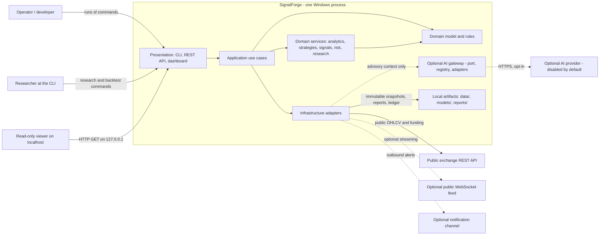

# System Context

Scope: the boundary of SignalForge, the humans and systems it talks to, what
crosses the boundary, and what is deliberately outside it.

## 1. What SignalForge is

A single-user, single-process, research-first crypto signal platform:

- ingests **public** exchange market data (no API keys required);
- normalizes and validates it into immutable datasets;
- computes indicators, features and market regimes;
- evaluates multiple strategies and combines them into a scored, explained
  signal proposal;
- applies deterministic risk rules;
- records everything needed to reproduce a research result;
- publishes read-only results to a CLI, a REST API and a dashboard.

It is **not** a trading system. It has no live-order adapter and no
account-management capability.

## 2. Context diagram

Solid arrows are the baseline path. Dashed arrows are optional and disabled
by default.

## 3. Actors

| Actor | Capability | Constraint |
|---|---|---|
| Operator / developer | Full local control: configure, ingest, run research, start the server | Trusted; the only actor who can authorize mutations |
| Researcher | Runs backtests, walk-forward, holdout evaluation, reporting | Cannot promote a strategy; cannot place orders |
| Read-only viewer | Browses dashboard and REST endpoints on loopback | GET only, no credentials, no mutations, no file access |
| Scheduler (internal) | Triggers pre-approved jobs at pre-approved times | Cannot bypass risk gates or safety switches |
| AI provider (external) | Returns advisory text | Untrusted; never alters direction, score or risk |
| Exchange (external) | Returns public market data | Untrusted; validated on arrival |

There is exactly one human role with write authority: the operator. There is
no multi-user model, no accounts, no authentication database, and no remote
access by default.

## 4. External systems

| System | Direction | Protocol | Required? | Trust |
|---|---|---|---|---|
| Exchange public market-data API (e.g. Binance via ccxt) | inbound | HTTPS REST | Yes for ingestion | Untrusted input, validated |
| Exchange public WebSocket | inbound | WSS | Optional | Untrusted input, validated |
| AI provider HTTP APIs | outbound | HTTPS | Optional, off by default | Untrusted output, schema-checked; reached only through the AI gateway |
| Notification channel (e.g. webhook, SMTP) | outbound | HTTPS | Optional, off by default | Credential-bearing, secret-managed |
| Local filesystem | bidirectional | OS calls | Yes | Semi-trusted; path-confined |
| SQLite file | bidirectional | sqlite3 | Target: canonical transactional store (not present today) | Local, single-writer, WAL |

No private exchange endpoint, no trading API, no custody service and no
payment system appears in the context — by design, not by omission.

## 5. Trust boundaries

1. **Exchange ↔ ingestion.** Every payload is untrusted. Schema, ordering,
   uniqueness, OHLC sanity, timestamp timezone and staleness are checked
   before anything is written.
2. **AI provider ↔ application.** The AI is an evidence-consuming advisor.
   Its output is parsed into a closed schema and can never set direction,
   numeric score, position size or risk outcome.
3. **HTTP client ↔ API/dashboard.** Requests are untrusted. Only GET routes
   exist; identifiers are validated; paths are confined; errors are sanitized.
4. **Application ↔ filesystem.** Writes are confined to `data/`, `models/`,
   `reports/` under the repository root.
5. **Research ↔ execution.** The research path has no adapter that can submit
   an order. This is a structural boundary, not a runtime flag.
6. **Scheduler ↔ risk.** A scheduled job may invoke a use case; it cannot skip
   a gate that the use case enforces.

## 6. Deployment context

- Windows 10/11, one repository checkout, one `uv`-managed `.venv`.
- One foreground process for CLI work; one foreground process for
  `sf serve` (API + dashboard together).
- No container, no orchestration, no service registry, no message broker.
- Loopback binding (`127.0.0.1`) by default; remote binding requires an
  explicit flag and is not part of the target defaults.
- Storage is local: Parquet snapshots, a SQLite metadata/ledger file, JSON
  reports and structured logs.

## 7. Runtime topology

| Mode | Processes | Network | Writes |
|---|---|---|---|
| Research/CLI | 1 foreground | Public market data only (when ingesting) | Datasets, reports, model artifacts |
| Server | 1 foreground (`sf serve`) | Loopback inbound; nothing outbound | None through HTTP |
| Paper simulation | 1 foreground, invoked explicitly | Public market data only | Paper ledger/state |
| Scheduled | 1 foreground process; optional | Public market data only | Datasets, reports |

There is no always-on daemon in the baseline. The scheduler, when enabled, is
an in-process loop started by an explicit command and stopped by the operator.

## 8. Assumptions

1. One operator, one machine, one checkout.
2. Public data is sufficient; no private keys are needed for the core product.
3. Any strategy may fail out of sample; the architecture must make that easy
   to observe and impossible to hide.
4. The machine has limited RAM; the design must degrade with an explicit
   error, never by silently truncating data.
5. The repository is the unit of reproducibility: dataset hashes, strategy
   versions, parameters and code version are recorded together.

## 9. What is explicitly outside the context

- Real-money execution, order routing, custody, deposits, withdrawals.
- Public hosting, authentication, multi-tenancy, billing.
- Deep-learning training infrastructure, GPUs, distributed compute.
- Market making, latency-sensitive execution, co-location.
- Any guarantee of profit, accuracy or deployability.
